- [SDCL Software Development Life Cycle](#sdcl-software-d- [SDCL Software Development Life Cycle](#sdcl-software-development-life-cycle)
  - [**1. Planning \& Reuirement  \& anlaysis**](#1-planning--reuirement---anlaysis)
    - [1.a Planning](#1a-planning)
    - [1.b Feasibility Study](#1b-feasibility-study)
    - [1.c Phase 2 — Requirements Analysis](#1c-phase-2--requirements-analysis)
      - [1.c.1 Functional Requirements (FR)](#1c1-functional-requirements-fr)
      - [1.c.2 Non Functional Requirements (NFR)](#1c2-non-functional-requirements-nfr)
  - [**2. Design**](#2-design)
    - [**A. Architecture Design** :](#a-architecture-design-)
    - [**B. Database Design**](#b-database-design)
    - [**Architecture Decisions**](#architecture-decisions)
    - [**C. UI / UX Design**](#c-ui--ux-design)
      - [**C.1.1 - GUI (Graphical user Interface):**](#c11---gui-graphical-user-interface)
      - [**C.2 - CLI (Command Line Interface):**](#c2---cli-command-line-interface)
    - [C.2.1- CLI Execution Cycle](#c21--cli-execution-cycle)
    - [C.2.2 - How Run Script on Terminal :](#c22---how-run-script-on-terminal-)
    - [C.3 - API (Application Programming Interface):-](#c3---api-application-programming-interface-)
      - [**C.3.1. What Is an API? (Explanation)**](#c31-what-is-an-api-explanation)
      - [**C.3.2. How API Works (Simple Explanation + Diagram)**](#c32-how-api-works-simple-explanation--diagram)
      - [**C.3.3. API Request \& Response  Structure**](#c33-api-request--response--structure)
      - [**C.3.4. API Style:**](#c34-api-style)
      - [**RESTFUL API (Representational State Transfer)**](#restful-api-representational-state-transfer)
      - [**GraphQL API**](#graphql-api)
      - [**SOAP API (Simple Object Access Protocol)**](#soap-api-simple-object-access-protocol)
      - [**WebSocket**](#websocket)
      - [**GRPC**](#grpc)
      - [**MQTT Pub/SUB**](#mqtt-pubsub)
    - [**3.Implementation  Write Code (Language) :**](#3implementation--write-code-language-)
      - [Write Code](#write-code)
      - [Software Configuration Management / Version Control](#software-configuration-management--version-control)
      - [Code Review](#code-review)
    - [**4.Testing :**](#4testing-)
    - [**5.Deployment and production  :**](#5deployment-and-production--)
    - [**6.maintance :**](#6maintance-)
      - [Corrective Maintenance(Fix Bug)](#corrective-maintenancefix-bug)
      - [Adaptive Maintenance](#adaptive-maintenance)
      - [Perfective Maintenance](#perfective-maintenance)
      - [Observability](#observability)
      - [Monitoring vs Observability](#monitoring-vs-observability)
    - [**7.Documentation :**](#7documentation-)
    - [SUMMARY](#summary)
  - [SDLC (Software Development Life Cycle) Models](#sdlc-software-development-life-cycle-models)
    - [Waterfall](#waterfall)
    - [V-Model](#v-model)
    - [Agile](#agile)
evelopment-life-cycle)
  - [**1. Planning \& Reuirement  \& anlaysis**](#1-planning--reuirement---anlaysis)
    - [1.a Planning](#1a-planning)
    - [1.b Feasibility Study](#1b-feasibility-study)
    - [1.c Phase 2 — Requirements Analysis](#1c-phase-2--requirements-analysis)
      - [1.c.1 Functional Requirements (FR)](#1c1-functional-requirements-fr)
      - [1.c.2 Non Functional Requirements (NFR)](#1c2-non-functional-requirements-nfr)
  - [**2. Design**](#2-design)
    - [**A. Architecture Design** :](#a-architecture-design-)
    - [**B. Database Design**](#b-database-design)
    - [**Architecture Decisions**](#architecture-decisions)
    - [**C. UI / UX Design**](#c-ui--ux-design)
      - [**C.1.1 - GUI (Graphical user Interface):**](#c11---gui-graphical-user-interface)
      - [**C.2 - CLI (Command Line Interface):**](#c2---cli-command-line-interface)
    - [C.2.1- CLI Execution Cycle](#c21--cli-execution-cycle)
    - [C.2.2 - How Run Script on Terminal :](#c22---how-run-script-on-terminal-)
    - [C.3 - API (Application Programming Interface):-](#c3---api-application-programming-interface-)
      - [**C.3.1. What Is an API? (Explanation)**](#c31-what-is-an-api-explanation)
      - [**C.3.2. How API Works (Simple Explanation + Diagram)**](#c32-how-api-works-simple-explanation--diagram)
      - [**C.3.3. API Request \& Response  Structure**](#c33-api-request--response--structure)
      - [**C.3.4. API Style:**](#c34-api-style)
      - [**RESTFUL API (Representational State Transfer)**](#restful-api-representational-state-transfer)
      - [**GraphQL API**](#graphql-api)
      - [**SOAP API (Simple Object Access Protocol)**](#soap-api-simple-object-access-protocol)
      - [**WebSocket**](#websocket)
      - [**GRPC**](#grpc)
      - [**MQTT Pub/SUB**](#mqtt-pubsub)
    - [**3.Implementation  Write Code (Language) :**](#3implementation--write-code-language-)
      - [Write Code](#write-code)
      - [Software Configuration Management / Version Control](#software-configuration-management--version-control)
      - [Code Review](#code-review)
    - [**4.Testing :**](#4testing-)
    - [**5.Deployment and production  :**](#5deployment-and-production--)
    - [**6.maintance :**](#6maintance-)
      - [Corrective Maintenance(Fix Bug)](#corrective-maintenancefix-bug)
      - [Adaptive Maintenance](#adaptive-maintenance)
      - [Perfective Maintenance](#perfective-maintenance)
      - [Observability](#observability)
      - [Monitoring vs Observability](#monitoring-vs-observability)
    - [**7.Documentation :**](#7documentation-)
    - [SUMMARY](#summary)
  - [SDLC (Software Development Life Cycle) Models](#sdlc-software-development-life-cycle-models)
    - [Waterfall](#waterfall)
    - [V-Model](#v-model)
    - [Agile](#agile)

## SDCL Software Development Life Cycle 
```Mermaid  
flowchart LR
    A[1. Planning & Requirement Analysis] --> B[2. Design]
    B --> C[3. Implementation]
    C --> D[4. Testing]
    D --> E[5. Deployment]
    E --> F[6. Maintenance]
    F --> G[7. Documentation]

```
### **1. Planning & Reuirement  & anlaysis**
   - Understand the client’s needs.
   - Gather business, functional, and non-functional requirements.
   - Perform system feasibility analysis (technical, financial, operational).

#### 1.a Planning 
``` txt 
Why are we building this?
What are we building?
Who will use it?
How much will it cost?
How long will it take?
Who will build it?
What are the risks?
Is it feasible?
```
#### 1.b Feasibility Study
+ **Technical Feasibility**
    هل عندنا التكنولوجيا والخبرة المطلوبة؟
+ **Economic Feasibility**
    هل المشروع يستحق تكلفته؟
    Development Cost = 500K 
    Expected Benefit = 50K
+ **Operational Feasibility**
هل المستخدمين والمؤسسة هيقدروا يستخدموه فعلًا؟
+ **Schedule Feasibility**
    هل ممكن نسلمه في الوقت المطلوب؟
**Just because we can build it doesn't mean we should build it.**


#### 1.c Phase 2 — Requirements Analysis
- "What should the system do?" Not  "How will we implement it?"
- Requirements = WHAT , Design = HOW
**Requirements tell us WHAT to build. Design tells us HOW to build it.**

##### 1.c.1 Functional Requirements (FR)
What can the system/user do?
<div dir="rtl">
دي الأشياء اللي الـ System لازم يعملها.
</div>

```txt
E-Commerce Example:
======================
User can register.
User can login.
User can search products.
User can add products to cart.
User can place an order.
User can pay online.
Admin can add products.
Admin can cancel orders.

```
##### 1.c.2 Non Functional Requirements (NFR)
النظام يعمل المطلوب بأي مستوى جودة وقيود؟

|FR|NFR|
|---|---|
|The user can login.| 95% of login requests.<br>must respond within 500 ms.|

```txt 
Performance Requirement
Performance
Security
Scalability
Availability
Reliability
Maintainability
Usability
Accessibility
Observability
Portability
Compliance
Disaster Recovery
```
**Functional Requirements define what the system does. Non-Functional Requirements define how well it does it.**
FR|NFR
---|---|
User can upload a video.|Upload supports files up to 2 GB.
User can login. | Passwords must be securely hashed.
User can search. | 95% of searches return within 1 second.

**Notes :**<br>
Agile ==> Requirements ===> UserStory + Acceptance Criteria <br>
**A requirement without acceptance criteria is open to interpretation.**
|User Stories|Acceptance Criteria|
|----|--|
As a \<user\> <br>I want \<goal\><br>So that \<benefit\> <br>|**Given:**<br>**when:**<br>**then:**<br>
As a customer,<br>I want to track my order,<br>so that I know when it will arrive.|**Given:**<br> The customer has an active order.<br>**When:**<br> The customer opens Order Tracking.<br>**Then:**<br>The current order status and estimated delivery time are displayed.


```txt
Building the wrong thing perfectly is still failure.
Perfect Code + Wrong Product=Failure
```

### **2. Design** 
How will we implement it?
```txt 
Client -> Load Balancer  -> Backend/API   -> Database  -> Cache
```
- Architecture , Components , Database , APIs , Communication , Authentication , Caching , Queues , Storage , Deployment topology

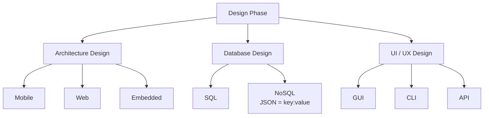
#### **A. Architecture Design** : 
- Based on platform: Mobile , Web , Embedded Systems
#### **B. Database Design**
- SQL Databases
- NoSQL Databases
    Example: JSON Format → {"key": "value"}
#### **Architecture Decisions**
- Every engineering decision is a trade-off.
- What do we gain, and what do we pay?
```
Cache
+ improve Performance(High Speed) : Instant replies; skip the database trip
+ Reduced Load : "Shielding your database from traffic spikes."
+ Better UX ➡️ Smooth

- Complexity :  Overhead (The extra code burden).
- Stale Data :  Expired (Old and inaccurate).
- Cache Invalidation : Timing (The hardest part to synchronize).
- Memory Cost : Expensive (Paying premium prices for RAM).

Microservices:
adv:
+ Independent deployment
+ Scalability
dis adv: 
- Network complexity (Latency - Not same Server)
- Observability complexity (Blindness - Where Error?)
- Distributed failures (Domino-Effect)
- DevOps overhead (Babysitting for 20 Server)
```
#### **C. UI / UX Design**
  - User interaction pathways:
    ```Mermaid 
    flowchart LR
        A0[Things] --> B0[Interface]
        B0-->C0[Things ]
               
        A1[User] -->|Clicks/Touch<br>Visual Interaction| GUI[GUI<br>Graphical User Interface]
        A1 -->|Typed Commands<br>Text Interaction| CLI[CLI<br>Command-Line Interface]
    
        GUI --> APP
        CLI --> APP
        
        A3[APP] <--> B3[API]
        B3<-->C3[APP]
        A[APP] -->|System Call| B[Operating System]

        C[APP] -->|Requset Network| D[API]
        D<-->F[Web Service]

        D -->|Response JSON/XML|C 
    ```
    <br>

    ```mermaid
        graph TD
            subgraph UI[User Interaction Layer]
                GUI
                CLI
            end

            subgraph Logic[Application Logic Layer]
                APP[App / Program / Service]
            end

            subgraph Dev[Developer Interaction Layer]
                API
            end

            GUI --> APP
            CLI --> APP
            API --> APP
    ```
    
    <br>


    ```Mermaid 
        sequenceDiagram
        participant User
        participant GUI
        participant CLI
        participant API
        participant App

        User->>GUI: Click/Touch/Input
        GUI->>App: Internal calls
        
        User->>CLI: Type Commands
        CLI->>App: Instruction Execution
        
        API->>App: Structured Request (HTTP/JSON/etc)
    ```
    ```txt
		Things ---> Interfacing --> Things 
		
        User -----> GUI/CLI ----> APP
		User---> GUI --->OS(APP)  #Graphical User Interface 
		Developer / Scripts ---> CLI --->OS(APP) #Command Line  Interface 
		CLI [Command Line Interface], GUI [Graphic User Interface]
		
        APP -----> API(Application Programming Interface) ---> APP 
    ```
##### **C.1.1 - GUI (Graphical user Interface):**
- Layers of a GUI based on a windowing system
    |                                                                               |                                                                                                                                                                                                                |
    | ----------------------------------------------------------------------------- | -------------------------------------------------------------------------------------------------------------------------------------------------------------------------------------------------------------- |
    |  |  |
##### **C.2 - CLI (Command Line Interface):**
- Very Fast & Powerful 
        ``` bash 
            touch ~/Desktop/c/ali ~/Music/ali2
            touch ~/Desktop/c/file{1..100}
        ```
- Servers typically run CLI (TTY) instead of GUI (less resource usage)
- Remote connections via SSH
- (Support   ==> Commands) Because OS Linux (Different GUI)
    CLI is consistent across Linux distributions (supports commands despite different GUIs)
- Falling in Love 

#### C.2.1- CLI Execution Cycle
```txt
        Terminal --Commands--> Shell [interpter] --> kernel -->HW  
```
``` bash
        echo $SHELL  # Current Shell 
			/usr/bin/bash 
```
#### C.2.2 - How Run Script on Terminal :
``` bash 
        #1) Create file  
            vi ~/Music/script1
                #!/usr/bin/python3    #which python3
                print(10)
        #2) Add Execute Permission file
            chmod +x ~/Music/script1
        #3) Run File using Path (Not Name )
            ~/Music/script1
        #4) Run Script using Name 
            # Add Path Folders of Commands in PATH Environment Variable  
            export PATH="$PATH":~/Music/script1
            # Run Script using Name 
            script1
            which script #==> /home/mina/Music/script1
        #5) To make changes permanent
            #you need to edit the file (bashrc) and then ensure the changes are loaded in new shell sessions.
            echo 'export PATH="$PATH":~/Music/script1' >> ~/.bashrc 
            #close Terminal and Open Again 
```
	
#### C.3 - API (Application Programming Interface):- 
##### **C.3.1. What Is an API? (Explanation)**
  - An API (Application Programming Interface) allows two different software systems to communicate.
  - Example:
    - Your mobile app sends a request → API receives it
    - API returns data → App shows it to you
    - API is like a waiter in a restaurant:
      - You (client) ask the waiter (API)
      - The waiter brings your food from the kitchen (server)
```txt 
    APP  ------ API ---> APP
    APP  ------API(System Call)--->  OS 
    C Under Linux ---> Systemcall Network ---> Profile [Aman POS]
    WebService=API+Internet
    APP(Mobile) --------> WebService [Weather.com]
```
##### **C.3.2. How API Works (Simple Explanation + Diagram)**
- A client sends a request (browser, app, program).
- The API server receives the request.
- The server processes it.
- It sends back a response (data).
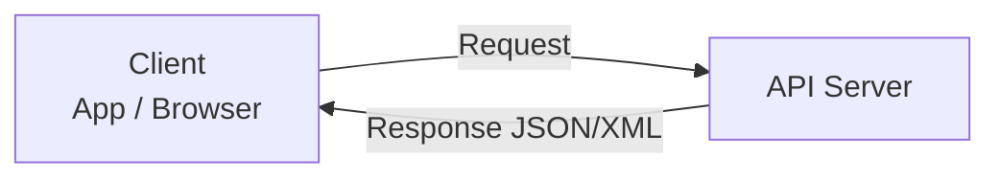
##### **C.3.3. API Request & Response  Structure**

| An API request usually contains: 	| The response contains: 	|
|---	|---	|
| - URL / Endpoint → "Where to go?"<br>- Method → GET, POST, PUT, DELETE  <br>- Headers → Authentication, Format   <br>- Body → Data (only for POST/PUT) 	| - Status Code → 200 OK, 404 Not Found<br>- Headers<br>- Body → usually JSON data 	|

```Mermaid 
    flowchart TD
        A[API Request]
        A --> B[Endpoint / URL]
        A --> C[HTTP Method]
        A --> D[Headers]
        A --> E[Body optional]

        A1[API Response]
        A1 --> B1[Status Code]
        A1 --> C1[Headers]
        A1 --> D1[Body JSON/XML]

```
##### **C.3.4. API Style:** 

| API Type      | Protocol  | Format      | Best For               | Style            |
| ------------- | --------- | ----------- | ---------------------- | ---------------- |
| **REST**      | HTTP      | JSON        | Web/Mobile             | Request–Response |
| **WebSocket** | TCP       | Text/Binary | Real-time apps         | Full-Duplex      |
| **GraphQL**   | HTTP      | JSON        | Flexible data fetching | Query-based      |
| **SOAP**      | HTTP/SOAP | XML         | Enterprise systems     | Contract-based   |
| **MQTT**      | TCP       | Binary      | IoT, sensors           | Pub/Sub          |
| **gRPC**      | HTTP/2    | ProtoBuf    | Microservices          | RPC              |

##### **RESTFUL API (Representational State Transfer)**
- Uses HTTP methods (GET, POST, PUT, DELETE).
  ```mermaid
  graph TB
      A[HTTP Methods]
      A --> B[GET - Retrieve Data]
      A --> C[POST - Create Data]
      A --> D[PUT - Replace Data]
      A --> E[PATCH - Update Part]
      A --> F[DELETE - Delete Data]
  ```
- Returns JSON (mostly).
- Resource-based URLs: /users/1
- RESTFUL API [API+Internet+HTTP+DataFormat(JSON/XML)+Methods[GET,POST,PUT,DELETE]]
- **REST API Flow (Sequence)**
  - Client sends GET request
  - Server replies with JSON
  - Client sends POST request
  - Server creates data
  ```mermaid
      sequenceDiagram
          participant Client
          participant Server

          Client->>Server: GET /users
          Server-->>Client: 200 OK + JSON Data

          Client->>Server: POST /users {data}
          Server-->>Client: 201 Created

  ```
##### **GraphQL API**
  - Client sends one query describing exactly what data it needs.
  - Server returns only the requested fields.
  - Single endpoint /graphql.
```Mermaid 
    sequenceDiagram
    participant Client
    participant GraphQL_Server

    Client->>GraphQL_Server: Query { user { id name email } }
    GraphQL_Server-->>Client: JSON { "user": { "id":1, "name":"John", "email":"john@mail.com" } }
```
##### **SOAP API (Simple Object Access Protocol)**
  - Uses XML format.
  - Strongly typed, strict structure.
  - Often used in banking & enterprise systems.
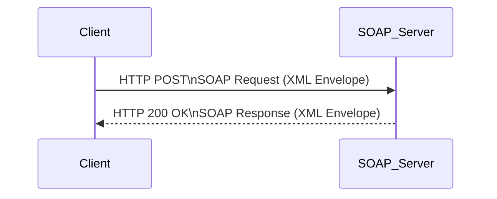
##### **WebSocket** 
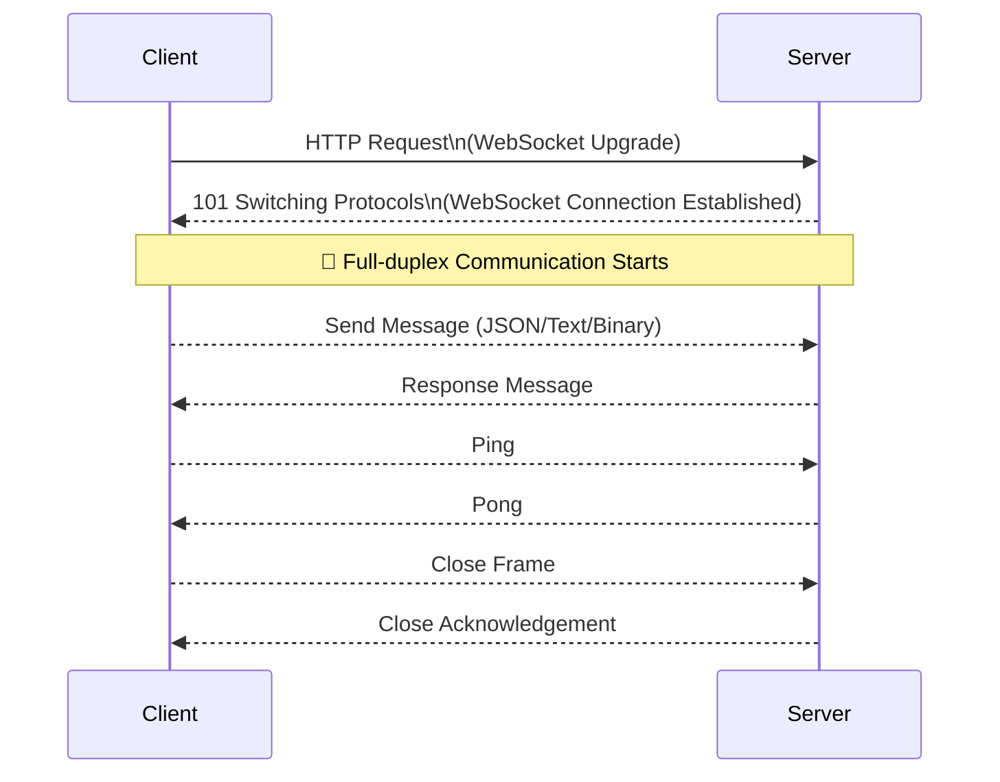

##### **GRPC**
- High-Speed RPC using Protocol Buffers
- Very fast
- Uses HTTP/2, binary binary format (Protocol Buffers)
- ideal for microservices.

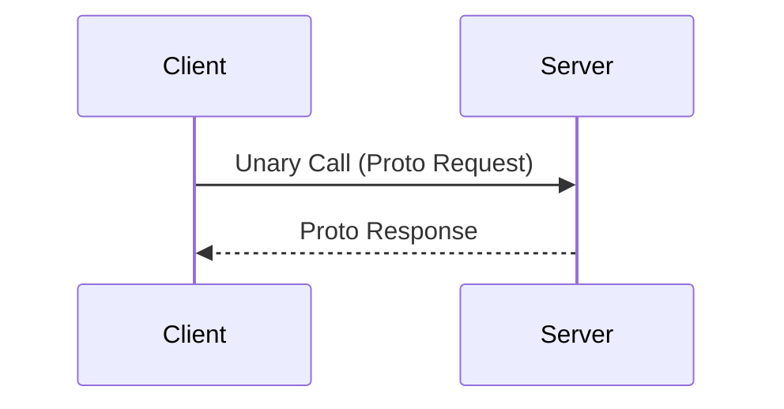
##### **MQTT Pub/SUB**
  - Lightweight protocol for IoT devices.
  - Works with Publish/Subscribe model.
  - Uses an MQTT broker (middle server).

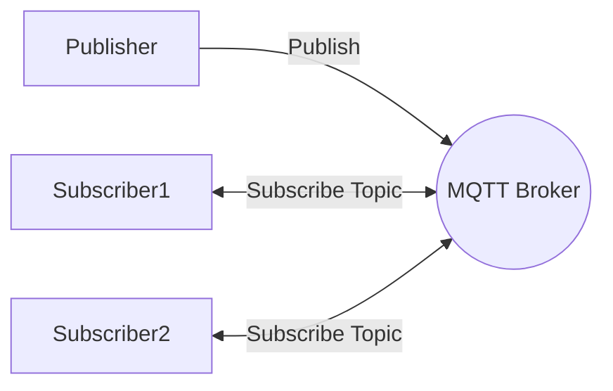
<br>

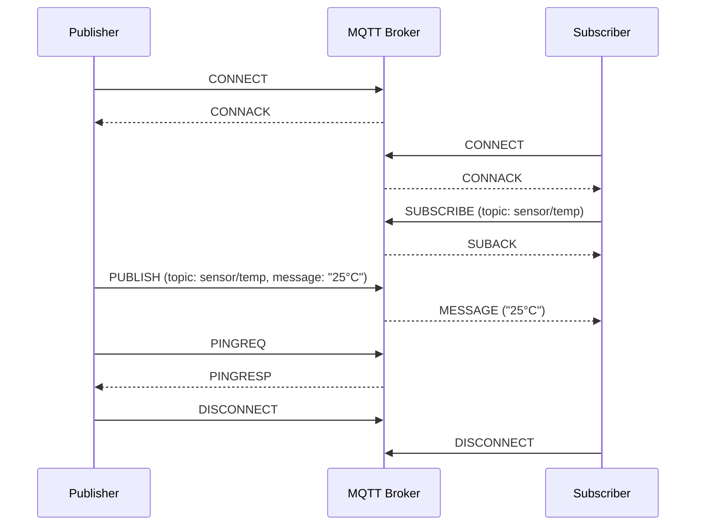


```txt
    Frontend APP 
			     <---JSON/XML--> RESTFUL API---> WebServer ---> DB Server  
	Mobile APP

	ESP32(WebServer)
	Laptop ---> Apache SW ---> (WebServer) 
	Laptop ---> Mongod or Mysqld ---> (DBServer)
	Protcol://ip(Domain):port/DBName(PageName)?conf=data&conf2=data
	mongodb://127.0.0.1:27017/?directConnection=true&serverSelectionTimeoutMS=2000&appName=mongosh+2.3.3

	Control Services in Linux :- 
	===============================
		systemctl start mongod.service 
		systemctl stop mongod.service 
		systemctl status mongod.service 
```
<br>

#### **3.Implementation  Write Code (Language) :**
##### Write Code 
- Writing actual code using the required programming languages.<br>
- 
<div dir="rtl">
هنا Developers يحولوا Design إلى Software.<br>
</div>
<br>

##### Software Configuration Management / Version Control
```txt 
Git Repository
main
│
├── develop
│
├── feature/login
│
├── feature/cart
│
└── bugfix/payment
```

##### Code Review
**Code is written once, but read many times.**
```txt
Code
 ↓
Commit
 ↓
Push
 ↓
Pull Request
 ↓
Code Review
 ↓
Changes
 ↓
Approve
 ↓
Merge
```
#### **4.Testing :**
- Ensuring the product is bug-free and meets requirements.
```txt 
           /\
          /  \       E2E
         /----\
        /      \     Integration
       /--------\
      /          \   Unit Tests
     /____________\
```
- **Unit Testing**
test small class/Function 
- **Integration Testing**
test Components together 
API -> Service -> Database
- **System / E2E Testing**
Login ->Add Product  -> Checkout -> Payment -> Order Created
- **Testing Non Functional** 
**Working is not the same as production-ready.**
    ```txt
    Performance Testing
    Load Testing
    Stress Testing
    Security Testing
    Usability Testing
    Compatibility Testing
    Regression Testing
    Acceptance Testing
    ```
#### **5.Deployment and production  :**
- Moving software to live environments where users access it.
- Deployment
- CD — Continuous Delivery / Deployment
  - Developers continuously merge their code.
  - Fail fast, fix early.
    ```txt 
        Commit → Build → Test → Static Analysis → Artifact
    ```
- CI — Continuous Integration
  - Works on my machine 😂
  - If it only works on your machine, it doesn't work.
  ```txt
        Code → Build → Test → Package → Deploy Staging → Deploy Production
  ```
  ```txt 
    Development
    Testing
    Staging
    Production
  ```

#### **6.maintance :**
- Fixing bugs
- Updating features 
- update code (improve code)
- Deployment is not the end. It is where reality begins.
#####  Corrective Maintenance(Fix Bug)
```txt 
Payment sometimes fails → Fix
```
##### Adaptive Maintenance(Everything outside your code changed)
- The outside world changed, so the system must adapt.
  - API Changes: The external payment provider changed their API, so you must update your integration.
  - OS / Platform Updates: Moving your application from an old version of Windows/Linux to a new one.
##### Perfective Maintenance (IMPROVEMENT (Making good code even better))
- The system works fine, but you want to make it better and more perfect.
  - Performance: Making code run faster to improve system speed.
  - UX / UI: Enhancing the user interface to make it easier to use.
##### Observability
  - What is happening inside my system? (Logs , Metrics , Traces)
  - You cannot improve what you cannot observe.
 
|||
|---|---------------------------|
User says:<br>"Checkout is slow."|Logs: Payment Service: Timeout connecting to Stripe API.<br>Metrics → latency increased<br>Trace:<br>API : 20ms<br>Order : 40ms<br>Payment : 3.8 sec  ← Problem<br>Database  : 30ms<br>

##### Monitoring vs Observability
- **Monitoring: "Is the system broken?"**
  - Monitoring is about the problems you already expect.
  - Monitoring tells you when something goes wrong.
  ```txt 
  The Question: "Is my server working normally?"
  CPU > 90%?
  Server Down?
  Disk Full?
  ```
- **Observability: "Why is the system broken?"**
  - Observability is much broader. It helps you find problems you never expected.
  It gives you enough detailed data (logs, metrics, and traces) to understand the system's internal state, even during a brand-new type of failure.
  - Observability gives you the data to understand why it went wrong.

#### **7.Documentation :**
- Creating technical and user documentation.


#### SUMMARY

```txt 
A Junior asks: “How do I code it?”
A Senior asks: “Why are we building it, what can go wrong, and what will it cost to maintain?”

Junior  →  "How do I CODE it?"
                  ↓
Mid     →  "How do I DESIGN it?"
                  ↓
Senior  →  "WHY are we building it?"
           "What are the TRADE-OFFS?"
           "How will it SCALE?"
           "What can FAIL?"
           "How will we MAINTAIN it?"
```
```txt 
Plan WHY → Define WHAT → Design HOW → CODE → TEST → DEPLOY → MONITOR → LEARN → REPEAT.
```
```mermaid
flowchart LR

    IDEA["💡 SOFTWARE IDEA<br/>Business Problem / Opportunity"]

    PLAN["📋 1. PLANNING<br/>Why should we build it?<br/>Is it worth building?"]

    REQ["📝 2. REQUIREMENTS<br/>WHAT should we build?<br/>Functional + Non-Functional"]

    DESIGN["🏗️ 3. DESIGN<br/>HOW will we build it?<br/>HLD + LLD"]

    CODE["💻 4. IMPLEMENTATION<br/>Code + Git + Code Review"]

    TEST["🧪 5. TESTING<br/>Does it work correctly?<br/>Does it work well?"]

    DEPLOY["🚀 6. DEPLOYMENT<br/>CI/CD + Production"]

    MAINTAIN["🔧 7. MAINTENANCE<br/>Monitor + Fix + Improve"]

    FEEDBACK["🔄 FEEDBACK<br/>Bugs + User Feedback<br/>New Requirements"]

    IDEA --> PLAN
    PLAN --> REQ
    REQ --> DESIGN
    DESIGN --> CODE
    CODE --> TEST
    TEST --> DEPLOY
    DEPLOY --> MAINTAIN
    MAINTAIN --> FEEDBACK

    FEEDBACK --> PLAN
    FEEDBACK --> REQ
```

<hr>

### SDLC (Software Development Life Cycle) Models

#### Waterfall 

- The Waterfall Model is a linear and sequential software development methodology 
  where each phase must be completed before the next one begins.
- summary :- 
  - Linear & sequential steps.
  - Each phase must be completed before starting the next.

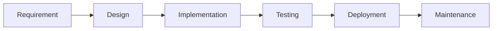

#### V-Model 
- The V-Model is essentially an extension of the Waterfall model but with a focus on testing and validation. 
- Each development phase has a corresponding testing phase, emphasizing the importance of verification (checking if the software is being built correctly) and validation (ensuring the software meets user needs).

	Low-Level Design -------> Unit Testing
	High-Level Design ------> Integration Testing
	System Design ----------> System Testing
   	Requirement Analysis ---> Acceptance Testing

- **Summary :-** 
  - Each development phase has a corresponding testing phase:

    | Development Phase    | Testing Phase       |
    | -------------------- | ------------------- |
    | Requirement Analysis | Acceptance Testing  |
    | System Design        | System Testing      |
    | High-Level Design    | Integration Testing |
    | Low-Level Design     | Unit Testing        |
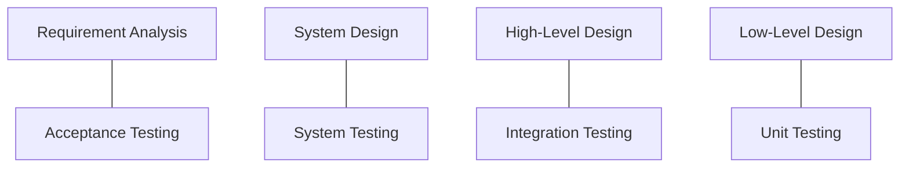
#### Agile 
- The Agile Model is an iterative and incremental approach to software development, where work is broken down into small, manageable units called sprints or iterations. 
- Agile emphasizes flexibility,collaboration,and customer feedback,allowing for changes throughout the development process.
- **Summary:-**
  - Iterative & incremental
  - Work done in sprints
  - High flexibility
  - Continuous customer feedback
  - Collaboration between teams
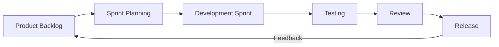