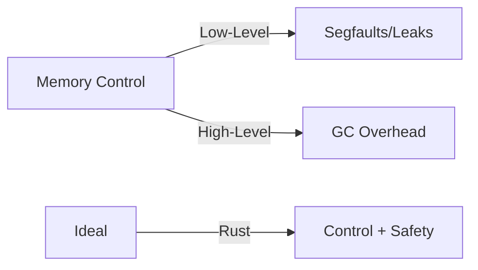
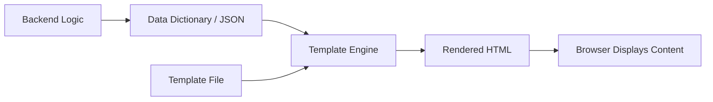
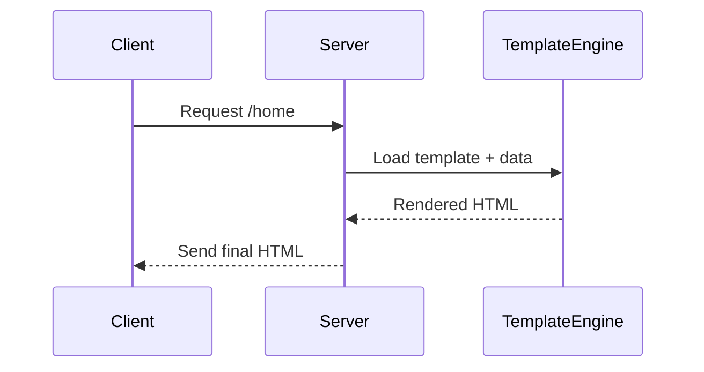

- [Why Multiple Languages Exist:](#why-multiple-languages-exist)
  - [Static vs dynamic and weak vs strong](#static-vs-dynamic-and-weak-vs-strong)
  - [Static vs. Dynamic vs. Hybrid Languages](#static-vs-dynamic-vs-hybrid-languages)
    - [Statically Typed Language Like {Rust, C, C++}](#statically-typed-language-like-rust-c-c)
    - [Dynamically Typed Language Like {PHP, Python, JavaScript}](#dynamically-typed-language-like-php-python-javascript)
    - [Hybrid Languages?](#hybrid-languages)
  - [Strongly Vs Weakly(Loosely) Languages](#strongly-vs-weaklyloosely-languages)
    - [Strong Language:](#strong-language)
    - [Loose Typing (or weak typing) Language:](#loose-typing-or-weak-typing-language)
    - [Hybrid Approaches](#hybrid-approaches)
  - [Types of Programming Languages Based on Memory Management 🖥️💾](#types-of-programming-languages-based-on-memory-management-️)
    - [1️⃣ Low-Level Languages (Manual Memory Management)](#1️⃣-low-level-languages-manual-memory-management)
    - [2️⃣ High-Level Languages (Automatic Memory Management)](#2️⃣-high-level-languages-automatic-memory-management)
    - [3️⃣ Mid-Level Languages (Hybrid Approach)](#3️⃣-mid-level-languages-hybrid-approach)
    - [Memory Error Spectrum](#memory-error-spectrum)
    - [Comparison Table: Memory Management in Different Languages](#comparison-table-memory-management-in-different-languages)
    - [Key Takeaways](#key-takeaways)
    - [Memory Leak Problem in C++](#memory-leak-problem-in-c)
      - [Causes of Memory Leaks in C++](#causes-of-memory-leaks-in-c)
    - [Best Practices to Avoid Memory Leaks](#best-practices-to-avoid-memory-leaks)
    - [General Best Practices to Avoid Fragmentation](#general-best-practices-to-avoid-fragmentation)
  - [Application Domains](#application-domains)
  - [Design Trade-offs](#design-trade-offs)
  - [Design Goals](#design-goals)
  - [Paradigm](#paradigm)
    - [Programming Paradigms: Simple Examples using Examples](#programming-paradigms-simple-examples-using-examples)
      - [**1. Linear Programming**](#1-linear-programming)
      - [**2. Procedural Programming**](#2-procedural-programming)
      - [**3. Object-Oriented Programming (OOP)**](#3-object-oriented-programming-oop)
      - [**4. Functional Programming**](#4-functional-programming)
      - [**Comparison of Paradigms**](#comparison-of-paradigms)
      - [**When to Use Each Paradigm**](#when-to-use-each-paradigm)
      - [**Combining Paradigms**](#combining-paradigms)
      - [**Summary**](#summary)
  - [HTML NoT Programming Language vs Template Engine](#html-not-programming-language-vs-template-engine)
    - [What Is a Template Engine?](#what-is-a-template-engine)
    - [Template Rendering Path (Backend to Browser)](#template-rendering-path-backend-to-browser)
    - [HTML vs Template Engine (Markdown Table)](#html-vs-template-engine-markdown-table)

### Why Multiple Languages Exist:
- No one-size-fits-all - Different problems need different tools.
- Evolution - New challenges require new solutions
- Specialization - Domain-specific optimizations.
- Human factors - Different thinking styles and preferences.

#### Static vs dynamic and weak vs strong 
- **static/dynamic**axis describes when type checking occurs, 
- **strong/weak** axis describes how strictly types are enforced and converted.
<br>

- **Static Typing** (e.g., Java, C++): Types checked at compile-time.
- **Dynamic Typing** (e.g., Python, Ruby): Types checked at runtime.
- **Weak typed(JS):** automatically converts types, sometimes unpredictably.
- **Strong Typed(Python)**:rejects mixing types without explicit conversion.

<br>
 

 

####  Static vs. Dynamic vs. Hybrid Languages
  - Choose static typing for reliability, performance, and large projects.
  - Choose dynamic typing for quick scripting, flexibility, and prototyping


| feature 	| Static Typing 	| Dynamic Typing 	|
|---	|---	|---	|
| Type Checking 	| At compile-time (before execution). 	| At runtime (during execution). 	|
| Type Declarations 	| Required or encouraged 	| Optional (types inferred or not needed) 	|
| Variable Types 	| Explicitly declared (e.g., int x = 5;). 	| Inferred at runtime (e.g., x = 5). 	|
| Flexibility 	| Less flexible (strict type rules). 	| More flexible (variables can change types). 	|
| Performance 	| Faster (optimized at compile-time). 	| Slower (runtime type checks). 	|
| Error Detection 	| Early (compile-time errors). 	| Late (runtime errors). 	|
| Tooling Support 	| Better IDE autocomplete & refactoring. 	| Limited tooling (harder to analyze). 	|
| Use Cases 	| Large-scale apps, performance-critical systems. 	| Scripting, rapid prototyping, dynamic web apps. 	|

##### Statically Typed Language Like {Rust, C, C++}
- Declare Data Type (Define DataType Before Run).
- Variables Types Are Static, Once You Declare It You Cannot Change.(Can't change type of Variable in Run Time)
- Type Of A Variable Is Known At Compile Time "Do Type Checking At Compile-Time"
- Have Better Performance At Run-Time Due To Not Needing To Check Types Dynamically
- Error Detected Earlier
- **Example**
```txt 
C (int x = 10;)
Java ( String name = "Alice"; )
Rust (let x: i32 = 5;)
TypeScript (let age: number = 25;
```
- **Example**
    ``` c++ 
        //C++ 
        int x=1;
        x="mina"; //Compiler Error 
    ```
- **Types**
    | Feature         | Primitive Data Types                        | Non-Primitive (Reference) Types                    |
    | --------------- | ------------------------------------------- | -------------------------------------------------- |
    | Example         | int x = 5;                                  | int* x = new int(5);                               |
    | Definition      | Predefined and built into the language.     | Usually defined by the programmer.                 |
    | Storage         | Stores the actual value directly in memory. | Stores a reference (address) to where the data is. |
    | Memory Location | Typically stored on the stack.              | Stored on the heap (reference on the stack).       |
    | Methods         | Cannot be used to call methods.             | Can call methods to perform operations.            |
    | Nullability     | Can never be null; always has a value.      | Can be null if no object is assigned.              |
    | Size            | Fixed size defined by the type.             | Variable size depending on the object.             |

##### Dynamically Typed Language Like {PHP, Python, JavaScript}
- Not Declare Data Type (Not Define DataType) 
- "Type Checking At Execution-Time" (Define DataType RunTime)
- Variables Types Are Dynamic, You Can Always Change It(Can Change DataType for Variable in RunTime)
- Error Can Be Detected After Execution
- Example
```txt 
Examples
Python (x = 10 → later x = "hello" )
JavaScript (let y = 5; y = "five"; )
Ruby (name = "Bob")
PHP ($count = 3; $count = "three"; )
```
- Example 
    ``` python 
        #Python 
        x=1 
        print(type(x)) #cls<int>
        x="mina" #Valid
        print(type(x)) #cls<str>
    ```

##### Hybrid Languages?
- Some languages combine both:
  - TypeScript: A statically typed version of JavaScript.
  - Python (with type hints): You can use mypy for static checking.
  - Kotlin, Swift: Support both dynamic and static behaviors.

| Statically Typed Languages                              | Dynamically Typed Languages                                 |
| ------------------------------------------------------- | ----------------------------------------------------------- |
| - Type checking is completed at compile time            | - Type checking is completed during runtime                 |
| - Explicit type declarations are usually required       | - Explicit declarations are not required                    |
| - Errors are detected earlier(during compilation.)      | - Type errors are detected later during execution           |
| - Variable assignments are static and cannot be changed | - Variable assignments are dynamic and can be altered       |
| - Produces more optimized code                          | - Produces less optimized code, runtime errors are possible |

#### Strongly Vs Weakly(Loosely) Languages
##### Strong Language:
- No implicit type coercion → Operations between incompatible types raise errors.
- can't Automatic Casting 
- more rigid when it comes to type conversions as they ensure that operations are performed only on compatible data types.
- By catching type-related errors early strongly typed languages minimize runtime errors and make debugging easier.
- Types are strictly checked, and conversions between incompatible types are either not allowed or require explicit actions.
  - Example: 
  ``` python 	
    #Python 
    print("str"+4) #TypeError: must be str, not int
    
    x="5" + 3  # TypeError: can't concatenate 'str' and 'int'
    
    #You must explicitly convert:
    x=int("5") + 3  # → 8

  ```
  ```Java
    //Java
    int num = 5;
  	String text = "hello";
  	String result = num + text;  // Compile-time error: incompatible types
   ```
##### Loose Typing (or weak typing) Language:
- Implicit type coercion → Automatically converts types (sometimes unpredictably).
- The language allows implicit type conversions.
- You can perform operations with different types without needing explicit casts or conversions.
- Example
    ``` JS
    //JS 
    //Ex1
     console.log("20"+20) // 2020
    //Ex2
    if( 5 == "5" ){
        console.log("true")
    }
    else{
            console.log("flase")
    }
    //Ex3
    if( 5 === "5" ){
        console.log("true")
    }
    else{
        console.log("flase")
    }
    // == in JS --> Compare Value  , === in js --> Compare Value , DataType

    "5" + 3  // → "53" (number → string)
    "5" - 3  // → 2 (string → number)
    [] + {}  // → "[object Object]" (WAT?!)

    var x="my string"
    var y=5
    console.log(x+y)
    //js Output : my string5
    let num = 10;
    let text = "20";
    let result = num + text; // "1020" (number coerced to string)
    // → JavaScript automatically converts types, sometimes unpredictably.
    // Static Typing (e.g., Java, C++): Types checked at compile-time.
    // Dynamic Typing (e.g., Python, Ruby): Types checked at runtime.
    ```
##### Hybrid Approaches
TypeScript: Adds strong typing to JavaScript.
Python + Mypy: Optional strong typing.


| Feature 	| Strongly Typed 	| Weakly (Loosely) Typed 	|
|---	|---	|---	|
| Type Enforcement 	| Strict type rules (no implicit conversions). 	| Allows implicit type conversions. 	|
| Example Behavior 	| "5" + 3 → Error (no auto-conversion). 	| "5" + 3 → "53" (JS/PHP auto-converts). 	|
| Safety 	| Prevents unintended type mixing. 	| Can lead to hidden bugs. 	|
| Flexibility 	| Less flexible (explicit conversions needed). 	| More flexible (but riskier). 	|
| Languages 	| Python, Java, Haskell, Rust. 	| JavaScript, PHP, C, Perl. 	|
| adv,disadv 	| ✅ Catches bugs early. <br>✅ Code clarity (explicit intent). <br>❌ More verbose (manual conversions). 	| ✅ Flexible for quick scripting. <br>❌ Hidden bugs (e.g., "5" + 3 = "53"). <br>❌ Harder to debug. 	|

| Typing Category | Description                                             | Error Detection        | Flexibility         | Common Examples  |
| --------------- | ------------------------------------------------------- | ---------------------- | ------------------- | ---------------- |
| Static          | Types known & checked at compile time                   | Early (compile-time)   | Lower flexibility   | C, C++, Java     |
| Dynamic         | Types checked at runtime                                | Late (run-time)        | Higher flexibility  | Python, JS, Ruby |
| Strong          | Strict: Few implicit conversions; invalid ops rejected  | Type errors flagged    | Lower type coercion | Python, Java     |
| Weak            | Permissive: Many implicit conversions/coercions allowed | Subtle errors possible | Higher coercion     | C, JavaScript    |


#### Types of Programming Languages Based on Memory Management 🖥️💾
- low level languages: self managed memory.
- high level languages: language managed memory.
#####  1️⃣ Low-Level Languages (Manual Memory Management)
- Examples: Assembly, C, C++
- Memory Management:
  - ✔ Direct access to memory using pointers.
  - ✔ Manual allocation (malloc/new) and deallocation (free/delete).
  - ✔ Prone to memory leaks and fragmentation.
- Use Case: High-performance applications (OS, game engines, embedded systems).
- Programmer controls all memory operations explicitly
``` C
    //Example (C Language - Manual Memory Management):
            #include <stdlib.h>
            int main() {
              // Explicit allocation
                int* ptr = (int*)malloc(sizeof(int));  // Allocate memory
                *ptr = 10;  // Use memory
                free(ptr);  // Free memory manually(Explicit deallocation)
                return 0;
            }
    //⚠️ Forgetting free(ptr) causes a memory leak!
```
|  	|  	|
|---	|---	|
| Pros: 	| - Maximum performance (no garbage collection overhead)<br>- Precise control over memory layout<br>- Ideal for systems programming (OS kernels, embedded systems) 	|
| Cons: 	| - Memory leaks if free() is forgotten.<br>- Dangling pointers if memory is accessed after freeing.<br>- Buffer overflow risks. 	|
| Tools for Safety: 	| - Rust: Ownership model (compile-time checks)<br>- Valgrind: Detects leaks in C/C++ 	| 

##### 2️⃣ High-Level Languages (Automatic Memory Management)
- **Examples:** Python, Java, JavaScript, C#
- **Memory Management:**
  - ✔ Automatic Garbage Collection (GC) removes unused objects.
  - ✔ No need for manual memory management.
  - ✔ Easier to use, but may have performance overhead.
- **Use Case:** Web development, enterprise applications, scripting.

- **Automatic memory management via:**
  - Garbage Collection (GC):
    - Tracing (Mark-and-Sweep)
    - Reference counting (Python)
  - Smart Pointers (C++'s unique_ptr, shared_ptr)


``` Python 

    #Example (Python):
    # Memory handled automatically
    lst = [1, 2, 3]  # Allocated
    lst = None       # Eligible for GC
    # Example (Python - Automatic Memory Management):
        def create_list():
            arr = [1, 2, 3, 4]  # No need to manually allocate/free memory

        create_list()  # Python's GC handles cleanup automatically

    # Python’s garbage collector removes unused objects.
```

|  	|  	|
|---	|---	|
| Pros: 	| - No manual free() calls needed<br>- Reduced crashes from memory errors<br>- Faster development cycles 	|
| Cons: 	| - GC pauses can affect performance<br>- Less control over memory layout.<br>- Higher memory usage (e.g., reference counting overhead). 	|


**Comparison Low-High Level**

| Feature 	| Low-Level 	| High-Level 	|
|---	|---	|---	|
| Allocation 	| Manual (malloc/new) 	| Automatic (new/constructors) 	|
| Deallocation 	| Manual (free/delete) 	| Garbage Collector 	|
| Performance 	| Faster (no GC overhead) 	| Slower (GC pauses) 	|
| Safety 	| Error-prone 	| Memory-safe 	|
| Use Cases 	| OS, game engines, HPC 	| Web apps, scripting 	|
| When to Choose? 	| Use Low-Level When:<br>- Building memory-constrained systems (embedded devices)<br>- Need predictable performance (real-time systems)<br>- Writing high-performance libraries (NumPy, TensorFlow) 	| Use High-Level When:<br>- Rapid application development<br>- Memory safety is critical (web services)<br>- Working with complex object graphs 	|

##### 3️⃣ Mid-Level Languages (Hybrid Approach)
- Examples: Rust, Go, Swift
- Memory Management:
  - ✔ Automatic memory management but with fine control.
  - ✔ Rust uses ownership model instead of GC.
  - ✔ Go uses garbage collection but allows manual tuning.
- Use Case: Performance-critical applications, systems programming.
- Rust:
  - Manual memory control + compile-time checks
    ``` rust 
    //Example (Rust - Ownership Model):
    fn main() {
        let s = String::from("Hello"); // Memory allocated
        let s2 = s; // Ownership transferred (no memory leaks)
    } // Memory automatically freed at the end of scope
    //Rust prevents memory leaks without a garbage collector.
    // Automatically freed when `s` goes out of scope
    ```
  - Key Insight: Modern languages (Rust, Swift) aim to bridge this gap with safer memory models.

- C++ Smart Pointers : 
    ```cpp
    std::unique_ptr<int> ptr(new int(42));  // Auto-deleted
    ```

##### Memory Error Spectrum

##### Comparison Table: Memory Management in Different Languages

| Language | Memory Management    | GC Support? | Manual Memory Control? |
| -------- | -------------------- | ----------- | ---------------------- |
| C        | Manual (malloc/free) | ❌ No        | ✅ Yes                  |
| C++      | Manual (new/delete)  | ❌ No        | ✅ Yes (Smart Pointers) |
| Java     | Automatic (GC)       | ✅ Yes       | ❌ No                   |
| Python   | Automatic (GC)       | ✅ Yes       | ❌ No                   |
| Rust     | Ownership Model      | ❌ No        | ✅ Yes                  |
| Go       | Automatic (GC)       | ✅ Yes       | ✅ Limited              |
| Swift    | Automatic (ARC)      | ✅ Yes       | ✅ Limited              |

##### Key Takeaways
- ✔ Low-level languages (C/C++) require manual memory management but offer high performance.
- ✔ High-level languages (Python, Java, JavaScript, C#) handle memory automatically using Garbage Collection.
- ✔ Mid-level languages (Rust, Go, Swift) provide memory safety with control, balancing performance and usability.


##### Memory Leak Problem in C++ 
- A memory leak in C++ happens when memory is allocated but never freed, causing increased memory usage over time. This can lead to slow performance, crashes, and system instability
###### Causes of Memory Leaks in C++
1. Forgetting to delete Dynamically Allocated Memory
``` c++
    #include <iostream>
    void memoryLeak() {
        int* ptr = new int(10);  // Allocating memory on the heap
        // No delete statement -> memory is leaked
    }
    int main() {
        memoryLeak();
        return 0;
    }
```
    - Problem: The allocated memory (new int(10)) is never freed.
    - Fix: Always delete the allocated memory.
``` c++
    void fixedMemoryLeak() {
        int* ptr = new int(10);
        delete ptr;  // Free memory
    }
```
#####  Best Practices to Avoid Memory Leaks
- ✔ Use Smart Pointers (std::unique_ptr, std::shared_ptr)
- ✔ Always delete what you new
- ✔ Use delete[] for arrays
- ✔ Check for circular references in shared_ptr
- ✔ Use tools like Valgrind and Address Sanitizer
##### General Best Practices to Avoid Fragmentation
- Problem: Free memory exists but is scattered in non-contiguous blocks, preventing large allocations.
  - ✔ Memory Compaction (Defragmentation)
  - ✔ Always free memory (free() in C, delete in C++).
  - ✔ Use smart pointers in C++ (std::unique_ptr, std::shared_ptr).
  - ✔ Avoid frequent allocations & deallocations (prefer object pooling).
  - ✔ Use std::vector, std::array instead of raw pointers in C++.
  - ✔ Enable garbage collection in Python (gc.collect()).
#### Application Domains
- Web Development (JS, PHP, Ruby)
- System Programming (C, C++, Rust)
- Data Science (Python, R, Julia)
- Mobile (Swift, Kotlin, Dart)
- AI/ML (Python, Julia)
- Games (C++,C#)
- Enterprise: Java, C#
#### Design Trade-offs
- Performance vs Ease of Use
- Safety vs Control
- Speed vs Portability
- Concurrency Models
- Memory Management
#### Design Goals
- Performance: C, C++
- Productivity: Python, Ruby
- Safety: Rust, Haskell
- Concurrency: Go, Erlang

``` txt 

1950s-60s       1970s-80s       1990s          2000s           2010s-Present
┌─────────────┐ ┌─────────────┐ ┌────────────┐ ┌─────────────┐ ┌─────────────┐
│ Fortran     │ │ C           │ │ Python     │ │ C#          │ │ Rust        │
│ COBOL       │ │ C++         │ │ Java       │ │ Scala       │ │ Go          │
│ Lisp        │ │ Pascal      │ │ JavaScript │ │ Swift       │ │ Kotlin      │
│ BASIC       │ │ Ada         │ │ Ruby       │ │             │ │ TypeScript  │
└─────────────┘ └─────────────┘ └────────────┘ └─────────────┘ └─────────────┘
Scientific      Systems &       Web &         Enterprise &    Safety &
Business        Structured      Productivity  Mobile         Concurrency
Computing       Programming     Languages     Development    Focus


Programming Languages Diversity
│
├── PARADIGMS
│   ├── Imperative (HOW) → C, Python [step-by-step instructions]
│   ├── OOP (Objects) → Java, C++ [modeling real-world entities with objects]
│   ├── Functional (Math) → Haskell, Scala [pure functions, immutability]
│   ├── Declarative (WHAT) → SQL, HTML [ specify what, not how]
│   └── Procedural (Steps) → C, Fortran [reusable procedures/functions]
│
├── DESIGN GOALS
│   ├── Performance → C, C++, Rust
│   ├── Safety → Rust, Haskell
│   ├── Productivity → Python, JavaScript
│   ├── Concurrency → Go, Erlang
│   └── Portability → Java, Python
│
├── APPLICATION DOMAINS
│   ├── Web → JavaScript, Python, Ruby
│   ├── Systems → C, C++, Rust
│   ├── Mobile → Swift, Kotlin, Dart
│   ├── AI/ML → Python, Julia
│   ├── Data → Python, R, MATLAB
│   └── Games → C++, C#
│
└── EVOLUTION DRIVERS
    ├── New paradigms
    ├── Performance needs
    ├── Safety requirements
    ├── New technologies
    └── Developer experience
```

#### Paradigm


| Aspect           | Imperative Programming               | Declarative Programming         |
| ---------------- | ------------------------------------ | ------------------------------- |
| Focus            | How tasks are done, step-by-step     | What the outcome should be      |
| Control Flow     | Explicit                             | Implicit                        |
| State Management | Manual                               | Automatic                       |
| Syntax           | Detailed instructions                | High-level expressions          |
| Examples         | C, Java, Python                      | SQL, HTML, Prolog               |
| Use Case         | Performance-critical, system control | High-level logic, configuration |


| **Feature**           | **Imperative Programming**                                                                                            | **Declarative Programming**                                                                                                                                                                                     |
| --------------------- | --------------------------------------------------------------------------------------------------------------------- | --------------------------------------------------------------------------------------------------------------------------------------------------------------------------------------------------------------- |
| **Focus**             | How to achieve results                                                                                                | What the results should be                                                                                                                                                                                      |
| **Control Flow**      | Explicitly defined (loops, conditions, sequences)                                                                     | Abstracted away; specify outcome, not steps                                                                                                                                                                     |
| **State Management**  | Mutable state                                                                                                         | Often emphasizes immutability                                                                                                                                                                                   |
| **Complexity**        | Can become complex as program grows                                                                                   | Simpler and more concise                                                                                                                                                                                        |
| **Performance**       | More control → potentially optimized code                                                                             | Depends on underlying engine or implementation                                                                                                                                                                  |
| **Typical Use Cases** | - System programming (OS, drivers) <br> - Game development <br> - Complex state management                            | - SQL database queries <br> - Web development (HTML, CSS) <br> - Configuration (Terraform, Ansible)                                                                                                             |
| **Example**           | int[] numbers = {1, 2, 3, 4, 5};<br>int totalSum = 0;<br>for (int number : numbers) {<br>    totalSum += number;<br>} | //Python<br>numbers = [1, 2, 3, 4, 5]<br>def add(x, y):<br>     return x + y<br>total_sum = reduce(add, numbers) //15<br><br>//Java<br>//Functional Approach :-<br>int totalSum = Arrays.stream(numbers).sum(); |

- Imperative [Step-by-step instructions] (C, Python, Java)
- Declarative [What, not how] : (SQL, HTML, Prolog) 
- Object-Oriented [class & Object ] : (Java, C++, C#)
- Functional [Pure functions] : (Haskell, Scala, Elixir)
- Procedural (C, Pascal, Fortran)

| Paradigm 	| Key Idea 	| Examples 	|
|---	|---	|---	|
| Imperative 	| Step-by-step instructions 	| C, Python (procedural) 	|
| Functional (FP) 	| Pure functions, immutability 	| Haskell, Clojure, JavaScript 	|
| OOP 	| Objects, inheritance, methods 	| Java, Python, C# 	|
| Logic 	| Rules and facts (Prolog-style) 	| Prolog, Datalog 	|
| Event-Driven 	| Responds to external events 	| JavaScript (Node.js), C# (WPF) 	|
| Concurrent 	| Parallel execution 	| Go, Erlang, Java Threads 	|
| Metaprogramming 	| Code that manipulates code 	| Lisp, Rust, Python 	|

__1. Imperative Programming__
- Focus: Describes how to perform tasks using statements that change a program’s state.
- Key Concepts:
   - Uses variables, loops, and conditionals.
   - Follows a step-by-step execution model.
   - Includes procedural and object-oriented sub-paradigms.
- Examples:
   - C (Procedural)
   - Python (Multi-paradigm, but supports imperative style)
   - Java (OOP-focused but allows imperative code)

__2. Declarative Programming__
- Focus: Describes What the program should accomplish without specifying how.
- Key Concepts:
   - No explicit control flow (e.g., loops).
   - Often higher-level and more abstract.
   - Includes functional, logic, and data-driven programming.
- Sub-Paradigms:
    - __A. Functional Programming (FP)__
       - Treats computation as mathematical functions.
       - Avoids mutable state and side effects.
       - Uses higher-order functions, recursion, and immutability.
       - Examples:
            - Haskell (Pure FP)
            - Clojure, Elixir (FP-first)
            - JavaScript, Python (Support FP but not pure)
    - B. __Logic Programming__
      - Defines rules and facts (rather than steps).
      - Uses backtracking and pattern matching to solve queries.
      - Examples:
        - Prolog
        - Datalog

    - C. __Data-Driven (e.g., SQL, HTML)__
      - Describes what data to retrieve/manipulate, not how.
      - Examples:
        - SQL (Database queries)
        - HTML/CSS (Declarative UI)

__3. Object-Oriented Programming (OOP)__
  - Focus: Organizes code into objects (data + methods).
  - Key Concepts:
      - Encapsulation (data hiding)
      - Inheritance (reuse via classes)
      - Polymorphism (same interface, different behavior)
  - Examples:
      - Java, C# (Class-based OOP)
      - Python, Ruby (Dynamic OOP)
      - JavaScript (Prototype-based OOP)

__4. Procedural Programming__
  - Focus: Structures code into procedures/functions called in sequence.
  - Key Concepts:
      - Top-down design (functions call other functions).
      - No classes (unlike OOP).
  - Examples: C , Pascal , Early versions of PHP

__5. Event-Driven Programming__
  - Focus: Code execution is triggered by events (e.g., clicks, messages).
  - Key Concepts:
      - Uses callbacks, listeners, or async/await.
      - Common in GUI and server applications.
   - Examples:
      - JavaScript (Node.js, Browser events)
      - C# (Windows Forms, WPF)
      - Python (Tkinter, asyncio)

__6. Concurrent & Parallel Programming__
  - Focus: Executes multiple tasks simultaneously (threads, processes, coroutines).
  - Key Concepts:
      - Threads vs. Processes
      - Locks, async/await, actors (Erlang/Elixir)
  - Examples:
      - Go (Goroutines)
      - Erlang/Elixir (Actor model)
      - Java (Threads, Executors).

__7. Metaprogramming__
  - Focus: Code that generates or modifies other code at runtime.
  - Key Concepts:
    - Macros (Lisp, Rust)
    - Reflection (Java, C#)
    - Templates (C++)
  - Examples:
    - Lisp (Homoiconicity – code as data)
    - Python (Decorators, eval())
    - Rust (Macros)

__Multi-Paradigm Languages__
  - Many modern languages support multiple paradigms:
    - Python (OOP + FP + Imperative)
    - JavaScript (OOP + FP + Event-Driven)
    - Scala (OOP + FP)
    - Rust (Imperative + FP + Metaprogramming).

  - Which Paradigm to Use?
    - OOP: Good for large-scale apps (GUI, enterprise software).
    - FP: Best for data processing, concurrency, math-heavy tasks.
    - Imperative: Low-level systems programming (OS, drivers).
    - Logic: AI, rule-based systems (e.g., expert systems).
  

##### Programming Paradigms: Simple Examples using Examples
- Python supports multiple programming paradigms, including procedural, functional, and object-oriented programming (OOP). Each paradigm has its own strengths and use cases. Below is an explanation of each paradigm with examples to help you understand their differences and when to use them.

###### **1. Linear Programming**
- Code executes line-by-line, top to bottom. No functions, no structure—just sequential instructions.
``` python
# Everything in sequence
price1 = 100
price2 = 50
price3 = 75

total = price1 + price2 + price3
print("Subtotal:", total)

discount_rate = 0.1
discount = total * discount_rate
final_price = total - discount

print("Discount:", discount)
print("Final Price:", final_price)
```
- **Characteristics:** Simple but repetitive. Hard to reuse or maintain.
<hr>

###### **2. Procedural Programming**
- Procedural programming focuses on writing procedures or functions that perform operations on data. It is based on the concept of procedure calls.

- Organizes code into reusable procedures/functions. Still sequential flow but modular.
- **Characteristics:** Functions for reusability. Data and functions are separate. Clear step-by-step logic.

- __Key Features:__
  - Emphasis on functions and procedures.
  - Data and functions are separate.
  - Typically uses top-down design.

- __Example1:__
    ``` Python
        # Procedural approach to calculate the area of a rectangle
        def calculate_area(length, width):
            return length * width

        length = 5
        width = 10
        area = calculate_area(length, width)
        print(f"Area: {area}")  # Output: Area: 50
    ```

- __Example2:__
    ```python
    def calculate_total(prices):
        total = 0
        for price in prices:
            total += price
        return total

    def apply_discount(amount, rate):
        discount = amount * rate
        return amount - discount

    def print_receipt(subtotal, discount_rate, final):
        print("Subtotal:", subtotal)
        print("Discount:", subtotal * discount_rate)
        print("Final Price:", final)

    # Main program flow
    prices = [100, 50, 75]
    subtotal = calculate_total(prices)
    final_price = apply_discount(subtotal, 0.1)
    print_receipt(subtotal, 0.1, final_price)
    ```

<hr>

###### **3. Object-Oriented Programming (OOP)**
- Object-oriented programming organizes code into objects, which are instances of classes. It focuses on encapsulation, inheritance, and polymorphism.
- Bundles data and behavior into objects. Models real-world entities.
- **Characteristics:** Data and methods together. Encapsulation. Models things as objects with properties and behaviors.

- __Key Features:__
  - Uses classes and objects.
  - Encapsulates data and behavior together.
  - Supports inheritance, polymorphism, and abstraction.

- __Example1:__
    ``` Python
    # OOP approach to calculate the area of a rectangle
    class Rectangle:
        def __init__(self, length, width):
            self.length = length
            self.width = width

        def calculate_area(self):
            return self.length * self.width

    # Create an object of the Rectangle class
    rect = Rectangle(5, 10)
    area = rect.calculate_area()
    print(f"Area: {area}")  # Output: Area: 50
    ```
- __Example2:__
    ```python
    class ShoppingCart:
        def __init__(self):
            self.items = []
            self.discount_rate = 0
        
        def add_item(self, price):
            self.items.append(price)
        
        def set_discount(self, rate):
            self.discount_rate = rate
        
        def get_subtotal(self):
            return sum(self.items)
        
        def get_final_price(self):
            subtotal = self.get_subtotal()
            discount = subtotal * self.discount_rate
            return subtotal - discount
        
        def print_receipt(self):
            subtotal = self.get_subtotal()
            print("Subtotal:", subtotal)
            print("Discount:", subtotal * self.discount_rate)
            print("Final Price:", self.get_final_price())

    # Using the object
    cart = ShoppingCart()
    cart.add_item(100)
    cart.add_item(50)
    cart.add_item(75)
    cart.set_discount(0.1)
    cart.print_receipt()
    ```

###### **4. Functional Programming**
- Functional programming treats computation as the evaluation of mathematical functions and avoids changing state or mutable data. It emphasizes immutability and pure functions.
- Treats computation as evaluation of mathematical functions. Avoids changing state.

- __Key Features:__
  - Uses pure functions (no side effects).
  - Relies on higher-order functions (functions that take other functions as arguments).
  - Encourages immutability (data is not modified after creation).

- **Characteristics:** Pure functions (same input = same output). Immutable data. Function composition. No side effects.
- **Functional Paradigm Characteristics**
  - **Declarative Style:** Focuses on what to compute rather than how to compute it, aligned with declarative programming principles.

  - **Pure Functions:** Functions produce the same output given the same input without side effects, making programs easier to predict and test.

  - **Immutability:** Data is immutable; instead of modifying data, new data structures are created.

  - **First-Class and Higher-Order Functions:** Functions are treated as first-class citizens, passed as arguments, returned from other functions, and composed.

  - **Function Composition:** Complex behaviors built by combining simpler functions.

  - **Recursion over Loops:** Uses recursion for repetition instead of imperative loops.
  - **Avoids Side Effects:** Keeps functions free of changing program state or interacting directly with I/O during computation.

- __Example1:__
    ``` Python
        # Functional approach to calculate the area of a rectangle
        calculate_area = lambda length, width: length * width

        length = 5
        width = 10
        area = calculate_area(length, width)
        print(f"Area: {area}")  # Output: Area: 50

        # Using map() to apply a function to a list
        numbers = [1, 2, 3, 4]
        squared = list(map(lambda x: x**2, numbers))
        print(squared)  # Output: [1, 4, 9, 16]
    ```
- __Example2:__
    ``` python 
    from functools import reduce

    # Pure functions (no side effects)
    def calculate_total(prices):
        return reduce(lambda acc, price: acc + price, prices, 0)

    def apply_discount(amount, rate):
        return amount * (1 - rate)

    def create_receipt(prices, discount_rate):
        subtotal = calculate_total(prices)
        final_price = apply_discount(subtotal, discount_rate)
        
        return {
            'subtotal': subtotal,
            'discount': subtotal * discount_rate,
            'final_price': final_price
        }

    # Composition of functions
    prices = [100, 50, 75]
    receipt = create_receipt(prices, 0.1)

    # Immutable data output
    print("Subtotal:", receipt['subtotal'])
    print("Discount:", receipt['discount'])
    print("Final Price:", receipt['final_price'])
    ```

###### **Comparison of Paradigms**

| Feature           | Procedural Programming   | Functional Programming            | Object-Oriented Programming (OOP)  |
| ----------------- | ------------------------ | --------------------------------- | ---------------------------------- |
| Focus             | Functions and procedures | Pure functions and immutability   | Objects and classes                |
| Data and Behavior | Separate                 | Separate                          | Encapsulated together              |
| State Management  | Mutable state            | Immutable state                   | Mutable state within objects       |
| Reusability       | Limited                  | High (via higher-order functions) | High (via inheritance)             |
| Example Use Case  | Simple scripts           | Data transformation pipelines     | Complex systems with relationships |


| Aspect                  	| Procedural Programming (POP)                                                                                                                                                                                                                      	| Object-Oriented Programming (OOP)                                                                                                                                                                                                             	| Functional Programming (FP)                                                                                                                                                                              	|
|-------------------------	|---------------------------------------------------------------------------------------------------------------------------------------------------------------------------------------------------------------------------------------------------	|-----------------------------------------------------------------------------------------------------------------------------------------------------------------------------------------------------------------------------------------------	|----------------------------------------------------------------------------------------------------------------------------------------------------------------------------------------------------------	|
| Core Concept            	| - "Program as a sequence of INSTRUCTIONS"<br>- Focus on procedures/functions that operate on data<br>- Breaks program tasks into procedures or functions.                                                                                         	| - "Everything is an OBJECT with BEHAVIOR"<br>- Model the world as interacting objects (Model real-world entities)<br>- Organizes code around objects encapsulating data and behavior                                                          	| - "Everything is a FUNCTION transforming DATA"<br>- Organizes code using pure functions and immutable data                                                                                               	|
| Principles              	| - Sequential execution of instructions<br>- Functions operate on shared data<br>- Top-down approach<br>- Data and functions are separate<br>- Emphasis on procedure calls                                                                         	| - Encapsulation (data + methods)<br>- Inheritance (code reuse)<br>- Polymorphism (flexible behavior)<br>- Abstraction (hide complexity)<br>- Objects communicate via messages                                                                 	| - Immutable data (no state changes)<br>- Pure functions (no side effects)<br>- First-class functions<br>- Higher-order functions<br>- Declarative style                                                  	|
| Focus                   	| Functions and step-by-step instructions                                                                                                                                                                                                           	| Objects representing real-world entities with attributes and methods                                                                                                                                                                          	| Pure functions that transform data without side effects                                                                                                                                                  	|
| State and Data Handling 	| Uses mutable state, global/local variables passed to functions                                                                                                                                                                                    	| Encapsulates state within objects, state changes via methods                                                                                                                                                                                  	| Immutability; avoids changing state, uses data transformations                                                                                                                                           	|
| Modularity              	| Functions or procedures                                                                                                                                                                                                                           	| Classes and objects                                                                                                                                                                                                                           	| Function composition and higher-order functions                                                                                                                                                          	|
| Execution Flow          	| Explicit control flow with loops and conditionals                                                                                                                                                                                                 	| Methods call to change state and invoke behavior                                                                                                                                                                                              	| Declarative composition, recursion replaces loops                                                                                                                                                        	|
| Side Effects            	| Allowed, procedures can modify variables                                                                                                                                                                                                          	| Allowed, objects can maintain and modify internal state                                                                                                                                                                                       	| Avoided, functions are pure                                                                                                                                                                              	|
| Strength                	|                                                                                                                                                                                                                                                   	| In-place modification - Efficient memory usage<br>Direct state access - Fast updates<br>Cache-friendly - Object locality                                                                                                                      	| Parallel processing - No shared state = easy parallelism<br>Lazy evaluation - Compute only what's needed<br>Memoization - Cache function results                                                         	|
| Choose When             	| ✅ Performance-critical systems<br>✅ Hardware interaction/low-level programming<br>✅ Simple algorithms with clear steps<br>✅ Embedded systems with limited resources<br>Examples: Scripts, Operating systems, device drivers, scientific computing 	| ✅ Modeling real-world entities with clear hierarchies<br>✅ Complex systems with changing state<br>✅ Team familiar with imperative thinking<br>✅ GUI applications, game development<br>Examples: Enterprise software, video games, CAD systems 	| ✅ Concurrent/parallel processing needs<br>✅ Data transformation pipelines<br>✅ Mathematical computations<br>✅ High reliability requirements<br>Examples: Financial systems, compilers, AI, data analysis 	|

###### **When to Use Each Paradigm**
- __Procedural Programming__
Best for simple, linear tasks.
Suitable for small scripts or one-off tasks.
Example: A script to process a file and generate a report.

- __Functional Programming__
Ideal for data transformation and pipelines.
Useful when working with immutable data or concurrent programming.
Example: Processing a list of data using map(), filter(), and reduce().

- __Object-Oriented Programming (OOP)__
Best for large, complex systems with relationships between entities.
Suitable for modeling real-world entities and reusable components.
Example: Building a GUI application or a game with multiple entities.

###### **Combining Paradigms**
- Python allows you to mix paradigms. For example, you can use OOP for structuring your program and functional programming for data processing.

- __Example: Combining OOP and Functional Programming__
    ``` Python
    class Rectangle:
        def __init__(self, length, width):
            self.length = length
            self.width = width

        def calculate_area(self):
            return self.length * self.width

    # List of rectangles
    rectangles = [Rectangle(5, 10), Rectangle(3, 7), Rectangle(4, 6)]

    # Use functional programming to calculate areas
    areas = list(map(lambda rect: rect.calculate_area(), rectangles))
    print(areas)  # Output: [50, 21, 24]
    ```

  
<hr>

###### **Summary**
- Procedural Programming: Focuses on procedures and functions. Best for simple tasks.
- Functional Programming: Emphasizes immutability and pure functions. Ideal for data transformation.
- Object-Oriented Programming (OOP): Organizes code into objects and classes. Best for complex systems.

|  Paradigm  |       Focus        |   Data & Logic   |             Best For             |
| :--------: | :----------------: | :--------------: | :------------------------------: |
|   Linear   |  Sequential steps  |  Mixed together  |          Simple scripts          |
| Procedural | Reusable functions |     Separate     |       Algorithms, scripts        |
|    OOP     | Objects & classes  | Bundled together | Large systems, modeling entities |
| Functional |   Pure functions   |    Immutable     |   Data processing, concurrency   |

- Modern languages (Python, JavaScript, Rust) support multiple paradigms—you can mix approaches based on what fits the problem best!
<hr>

#### HTML NoT Programming Language vs Template Engine 
- HTML is NOT a programming language.
- HTML is a markup language used to declare structure.
- A template engine adds logic (variables + loops + conditions) to HTML, making it dynamic.

**Is HTML a Programming Language?**
- ❌ No. HTML is not a programming language.
- HTML is a markup language used to define the structure of a webpage. It does not have:
  - Variables
  - Logic
  - Loops
  - Functions
  - Conditionals
  - Algorithms
- So it cannot perform computations or control program flow.
    Browser <----Server(Template Engine -----Template(HTML+Loop))<===>DB
#####Why HTML is Not a Programming Language**
- Because HTML only describes content, it does NOT:
    - make decisions
    - perform operations
    - run loops
    - store/manipulate data
    - execute logic
- It is declarative, not imperative.
- ```<h1>Hello World</h1>```
- This simply describes what to display. It doesn’t execute anything

##### What Is a Template Engine?

- A template engine is a tool that combines HTML + logic (variables, loops, conditions) to generate dynamic pages.
    Examples:
    - EJS
    - Handlebars
    - Pug
    - Jinja2 (Python)
    - Thymeleaf (Java)

- Template engines can insert data, loop, condition, and execute basic logic.
- Example (EJS Template):
    ```JS 
    <h1>Hello <%= user.name %></h1>

    <% if (isAdmin) { %>
        <button>Delete User</button>
    <% } %>
    ```
- Example (Jinja2 Template):
    ```python 
        <ul>
        
            {% if num % 2 == 0 %}
                <li>{{ num }} is Even</li>
            
                <li>{{ num }} is Odd</li>
            
        
        </ul>
    ```
- This contains logic, which HTML alone cannot do.
##### Template Rendering Path (Backend to Browser)



##### HTML vs Template Engine (Markdown Table)
| Feature / Aspect          | **HTML**                      | **Template Engine**                                  |
| ------------------------- | ----------------------------- | ---------------------------------------------------- |
| **Type**                  | Markup Language               | HTML + Logic Generator                               |
| **Programming Language?** | ❌ No                          | ❌ Not exactly, but contains **programming features** |
| **Purpose**               | Describe structure & content  | Generate dynamic HTML using data + logic             |
| **Supports Variables**    | ❌ No                          | ✔ Yes                                                |
| **Supports Loops**        | ❌ No                          | ✔ Yes (e.g., `for`, `each`)                          |
| **Supports Conditions**   | ❌ No                          | ✔ Yes (e.g., `if`, `else`)                           |
| **Dynamic Pages**         | ❌ Cannot generate dynamically | ✔ Can generate dynamic content                       |
| **Examples**              | `<h1>Hello</h1>`              | `<h1>Hello <%= name %></h1>`                         |
| **Who Uses It?**          | Browsers                      | Backend frameworks (Node.js, Python, PHP, Java)      |


