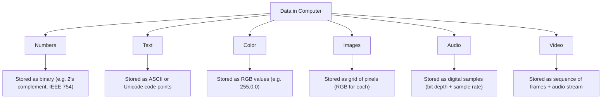
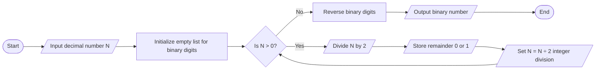

### Data & Memory 
#### Type of Data ? 

<center>


**Representing Real-World Data In The Computer**
</center>

- **Binary   0  1**
- **units of Informations [data]**
    - smallest unit of data  -----------> bit [0 or 1]
    - 8 bit   --------------------------> 1 Byte 
    - 1024 Byte ------------------------> KiloByte 
    - 1024 KiloByte --------------------> MegaByte
    - 1024 MegaByte --------------------> GigaByte

#### **Number Decimal to binary**

```txt
127 
         divide    reminder                     
127/2 ==>  63   ==> 1
63/2  ==>  31   ==> 1
31/2  ==>  15   ==> 1
15/2  ==>  7    ==> 1
7/2   ==>  3    ==> 1
3/2   ==>  1    ==> 1
3/2   ==>  1    ==> 1
1/2   ==>  0    ==> 1
01111 1111
==================================
128   64   32   16   8   4   2   1
0      1    1    1   1   1   1   1
==================================
11 bit ===> 2Byte 
0000 0XXX XXXX XXXX
==================================
``` 
- **binary  to Decimal**
    
    <br>
    


- **Hex Decimal** 
(0-->0000)    (1-->0001)   (2-->0010)  (3-->0011)  (4-->0100)
(5-->0101)    (6-->0110)   (7-->0111)  (8-->1000)  (9-->1001)
(A-->1010)    (B-->1011)   (C-->1100)  (D-->1101)  (E-->1110)
(F-->1111) 


### How Different Data Types Are Stored in Memory

Every piece of data (numbers, characters, etc.) is stored in binary form (0s and 1s) inside computer memory (RAM).
Different data types occupy different sizes of memory and have specific storage formats.

#### 🧮 1. Numbers

| Type               | Example | Binary Representation                | How It’s Stored                                                  |
| ------------------ | ------- | ------------------------------------ | ---------------------------------------------------------------- |
| **Integer**        | 25      | `00011001`                           | Stored directly as binary digits (2’s complement for negatives). |
| **Floating Point** | 12.5    | `0 10000010 10010000000000000000000` | IEEE 754 format: 1 sign bit, exponent, and mantissa.             |

5 (8-bit) → 11111011 (2’s complement)
12.5 (float) → 01000001010010000000000000000000

**Integers type**
| Type    | Typical Size      | Example | Stored As (Binary)                    | Notes                                      |
| ------- | ----------------- | ------- | ------------------------------------- | ------------------------------------------ |
| `int`   | 4 bytes (32 bits) | 25      | `00000000 00000000 00000000 00011001` | Stored in **2’s complement** for negatives |
| `short` | 2 bytes           | 25      | `00000000 00011001`                   | Smaller range                              |
| `long`  | 8 bytes           | 25      | `000...00011001` (64 bits)            | Larger range                               |

**Floating Point Types (float, double)**
| Type     | Size    | Example | Stored As (Binary)        | Notes                                            |
| -------- | ------- | ------- | ------------------------- | ------------------------------------------------ |
| `float`  | 4 bytes | 12.5    | IEEE 754 format           | 1 bit sign + 8 bits exponent + 23 bits mantissa  |
| `double` | 8 bytes | 12.5    | IEEE 754 double precision | 1 bit sign + 11 bits exponent + 52 bits mantissa |

```c
Example (float 12.5):
Sign = 0 (positive)
Exponent = 10000010
Mantissa = 10010000000000000000000
Binary = 0 10000010 10010000000000000000000
```

#### 🔡 2. Text
- Text characters are stored as numbers, according to encoding systems like:
    | Encoding            | Example         | Binary                       |
    | ------------------- | --------------- | ---------------------------- |
    | **ASCII**           | 'A' → 65        | `01000001`                   |
    | **Unicode (UTF-8)** | 'A' → 65        | `01000001`                   |
    |                     | 'あ' (Japanese) | `11100011 10000010 10000010` |

    Hi" → H (01001000) i (01101001)
    Memory: 01001000 01101001

- **Character Types (char)**
    | Type                   | Size            | Example | Stored As (Binary)      | Notes                                    |
    | ---------------------- | --------------- | ------- | ----------------------- | ---------------------------------------- |
    | `char`                 | 1 byte (8 bits) | `'A'`   | `01000001`              | Stored as **ASCII** or **Unicode** value |
    | `wchar_t` / `char16_t` | 2–4 bytes       | `'あ'`  | Unicode (UTF-16/UTF-32) | Used for wide characters                 |
    
- **string** : Strings are arrays of characters stored sequentially in memory.
    Example:
    "CAT"
    | Character              | ASCII | Binary   |
    | ---------------------- | ----- | -------- |
    | C                      | 67    | 01000011 |
    | A                      | 65    | 01000001 |
    | T                      | 84    | 01010100 |
    | `\0` (null terminator) | 0     | 00000000 |

  💡 Memory Layout:
    Address:   1000 1001 1002 1003
    Content:   67   65   84   0
#### 🎨 3. Colors
- Colors are stored as numbers too — usually RGB (Red, Green, Blue) values.
Color ==> RGB (Red,Green,Blue) 0-255 ==> Binary 

| Color     | RGB Values  | Binary Representation        |
| --------- | ----------- | ---------------------------- |
| **Red**   | (255, 0, 0) | `11111111 00000000 00000000` |
| **Green** | (0, 255, 0) | `00000000 11111111 00000000` |
| **Blue**  | (0, 0, 255) | `00000000 00000000 11111111` |

| Color  | RGB           | Hex Color Code |
| ------ | ------------- | -------------- |
| Black  | (0,0,0)       | #00 00 00      |
| Blue   | (0,0,255)     | #00 00 FF      |
| Gray   | (128,128,128) | #80 80 80      |
| Green  | (0,128,0)     | #00 80 00      |
| Purple | (128,0,128)   | #80 00 80      |
| Red    | (255,0,0)     | #FF 00 00      |
| white  | (255,255,255) | #FF FF FF      |

- Each color channel is typically 1 byte (8 bits) → total 24 bits per pixel.
🧩 So, one pixel = 24 bits = 3 bytes

#### 🖼️ 4. Images

- Images are made up of pixels, and each pixel stores color information (RGB).
- Images = (Height)720 Pixel * (Width)1280 Pixel
- Pixel ==> Array of Color 
- Images ==> Matrix of Color ==> Binary 

Example: a 100×100 image =
→ 10,000 pixels × 3 bytes per pixel = 30,000 bytes (~30 KB)

📦 Stored as:
```less
Pixel[0]: (255, 0, 0)
Pixel[1]: (0, 255, 0)
Pixel[2]: (0, 0, 255)
...
```
```txt 
To convert an image into a matrix of colors, 
where each pixel in the image is represented by its RGB (Red, Green, Blue) values, 
you can use Python libraries like OpenCV or Pillow. The image will be loaded as an array (or matrix), 
where each element contains the RGB color value of a pixel.

pip install opencv-python or pip install pillow
                        ====================================================================
C language  (To convert an image to binary (black and white) in C, you can use the OpenCV library)
Write C program that :-
    1- loads an image, 
    2- converts it to grayscale, 
    3- applies binary thresholding to convert it to a binary image.
```
**Graphics as a Collection of Pixel Bytes**


#### 🎧 5. Audio

Audio is stored as a series of samples (sound wave amplitudes) captured over time.
Formats (like PNG, JPEG) compress this pixel data to save space.
| Property        | Meaning                                       |
| --------------- | --------------------------------------------- |
| **Sample Rate** | Number of samples per second (e.g. 44,100 Hz) |
| **Bit Depth**   | Bits per sample (e.g. 16-bit, 24-bit)         |
| **Channels**    | Mono (1), Stereo (2)                          |
🧩 Example:

CD-quality audio → 44,100 samples/sec × 16 bits/sample × 2 channels
= 1.4 million bits/sec ≈ 176 KB/sec

Each sample = a binary number representing the sound’s amplitude.

#### 6. Videos

A video = sequence of images (frames) + audio.

Each frame is like an image (pixels), and they are shown quickly (e.g. 30 fps).
Audio is stored alongside it.
📦 Stored as:
``` mathematica
Frame 1: Image Data
Frame 2: Image Data
...
Audio Stream: Sample Data
```

Modern formats (MP4, AVI) compress both image and sound using codecs (like H.264, AAC).

#### in Summary 

| Data Type   | Representation in Memory            | Example                            |
| ----------- | ----------------------------------- | ---------------------------------- |
| **Numbers** | Binary (2’s complement or IEEE 754) | `12.5 → 0100000101001000...`       |
| **Text**    | Character encodings (ASCII/Unicode) | `'A' → 01000001`                   |
| **Color**   | RGB values (3 bytes)                | Red → `11111111 00000000 00000000` |
| **Images**  | Grid of pixels (each pixel = RGB)   | PNG/JPEG compression               |
| **Audio**   | Sequence of amplitude samples       | 16-bit PCM data                    |
| **Video**   | Series of images + audio track      | MP4, AVI, etc.                     |
