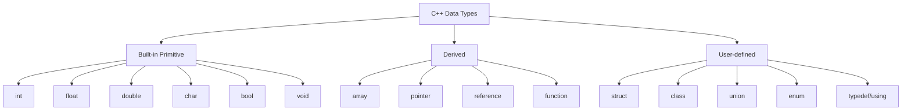
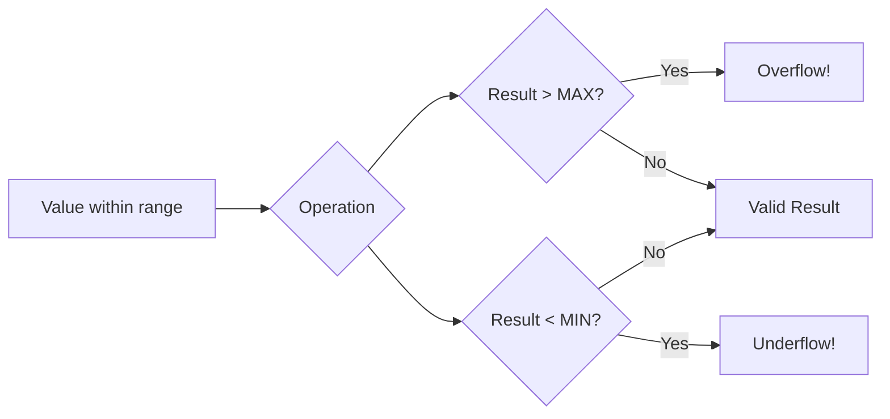

## Table of Content
- [Table of Content](#table-of-content)
  - [What is C++?](#what-is-c)
  - [Getting Started - Write our First Hello-world C++ Program](#getting-started---write-our-first-hello-world-c-program)
    - [Step 1: Write the Source Code:](#step-1-write-the-source-code)
    - [Step 2: Build the Executable Code: Compile and Link (aka Build) the source code "hello.cpp" into executable code ("hello.exe" in Windows or "hello" in UNIX/Linux/Mac).](#step-2-build-the-executable-code-compile-and-link-aka-build-the-source-code-hellocpp-into-executable-code-helloexe-in-windows-or-hello-in-unixlinuxmac)
    - [Step 3: Run the Executable Code: Execute (Run) the program.](#step-3-run-the-executable-code-execute-run-the-program)
    - [Skeleton of a C Program](#skeleton-of-a-c-program)
    - [Skeleton of a C++ Program](#skeleton-of-a-c-program-1)
    - [C/C++ Program Compilation Toolchain](#cc-program-compilation-toolchain)
    - [Static Linking Vs Dynamic Linking](#static-linking-vs-dynamic-linking)
    - [Static Library Vs Dynamic Library in C/C++](#static-library-vs-dynamic-library-in-cc)
    - [Types of Errors](#types-of-errors)
      - [Development Errors](#development-errors)
      - [Run Time](#run-time)
  - [Variables](#variables)
    - [what is Variable](#what-is-variable)
    - [important Notes](#important-notes)
    - [Name Resolution in C++](#name-resolution-in-c)
      - [Rule of Thumb:](#rule-of-thumb)
    - [The sizeof Operator](#the-sizeof-operator)
    - [Variable Declaration vs Definition](#variable-declaration-vs-definition)
    - [Declaration Forms Cheat Sheet](#declaration-forms-cheat-sheet)
  - [Output and Input](#output-and-input)
    - [I/O in C (Input / Output)](#io-in-c-input--output)
      - [Output in C → printf()](#output-in-c--printf)
        - [Common Format Specifiers:](#common-format-specifiers)
    - [Output in C++ → printf()](#output-in-c--printf-1)
    - [Input in C → scanf()](#input-in-c--scanf)
    - [Input in C++ → cin](#input-in-c--cin)
  - [DataTypes](#datatypes)
    - [What Are Data Types in C++?](#what-are-data-types-in-c)
    - [DataTypes](#datatypes-1)
      - [🧩1. Basic (Built-in) Data Types](#1-basic-built-in-data-types)
      - [🧮 2. Derived Data Types](#-2-derived-data-types)
      - [🧱 3. User-Defined Data Types](#-3-user-defined-data-types)
      - [🧮 4. Type Modifiers](#-4-type-modifiers)
      - [summary Table](#summary-table)
    - [Qualifiers / Modifiers](#qualifiers--modifiers)
    - [C++ Specific / Extended Types](#c-specific--extended-types)
  - [OverFlow](#overflow)
    - [What is Overflow?](#what-is-overflow)
    - [Why Does Overflow Happen?](#why-does-overflow-happen)
    - [Visual Representation of signed Overflow](#visual-representation-of-signed-overflow)
    - [Visual Representation of unsigned Overflow](#visual-representation-of-unsigned-overflow)
    - [Examples](#examples)
      - [Example 1: Signed Char Overflow](#example-1-signed-char-overflow)
      - [Example 2: Integer Overflow](#example-2-integer-overflow)
      - [Example 3: Multiplication Overflow](#example-3-multiplication-overflow)
      - [Example 4: Signed/Unsigned Mixing](#example-4-signedunsigned-mixing)
      - [Example 5: Loop Counter Overflow](#example-5-loop-counter-overflow)
    - [Detection and Prevention](#detection-and-prevention)
      - [Enable compiler warnings](#enable-compiler-warnings)
      - [Use Larger Data Types](#use-larger-data-types)
      - [Validate input ranges](#validate-input-ranges)
      - [Use safe arithmetic functions (Check Before Operations)](#use-safe-arithmetic-functions-check-before-operations)
      - [Avoid mixing signed and unsigned](#avoid-mixing-signed-and-unsigned)
  - [Implicitly (Auto Conversion) and Explicitly casting](#implicitly-auto-conversion-and-explicitly-casting)
    - [Implicitly Casting](#implicitly-casting)
    - [Explicitly Casting](#explicitly-casting)
    - [Examples](#examples-1)
      - [1. Narrowing Conversion (int → char)](#1-narrowing-conversion-int--char)
      - [2.Integer Promotion / Signed vs Unsigned](#2integer-promotion--signed-vs-unsigned)
      - [3.Floating-Point to Integer Truncation](#3floating-point-to-integer-truncation)
      - [4.implicit conversion / integer division pitfall](#4implicit-conversion--integer-division-pitfall)
      - [5.Mixed-Type Arithmetic](#5mixed-type-arithmetic)
      - [6.Boolean Conversion Pitfall](#6boolean-conversion-pitfall)
      - [7.Implicit Conversion in Function Calls](#7implicit-conversion-in-function-calls)
      - [8. Pointer Casting (C/C++) (Excplicit)](#8-pointer-casting-cc-excplicit)
      - [How to Avoid Implicit Conversion Problems](#how-to-avoid-implicit-conversion-problems)
  - [Typedef in C/C++](#typedef-in-cc)
    - [Why Use typedef?](#why-use-typedef)
    - [Examples of typedef](#examples-of-typedef)
    - [Use Cases](#use-cases)
      - [Platform-Independent Code](#platform-independent-code)
    - [Common use : Structs, pointers, function pointers](#common-use--structs-pointers-function-pointers)
    - [Standard Fixed-Width Data Types](#standard-fixed-width-data-types)

### What is C++?

- A high-performance programming language

- Used for system programming, games, applications, robotics, etc.

- Supports procedural, object-oriented, and generic programmin
### Getting Started - Write our First Hello-world C++ Program
#### Step 1: Write the Source Code: 
``` c++ 
/*
 * First C++ program that says hello (hello.cpp)
 */
#include <iostream>    // Needed to perform IO operations (C++ Library)
#include <stdio.h> // Needed to Perform IO Operation (C Library)
using namespace std;
 
int main() {                        // Program entry point
   cout << "hello, world" << endl;  // Say Hello
   printf("hello, world\n"); //say Hello 
   return 0;                        // Terminate main()
}                                   // End of main function
```
- #include <iostream> → allows input/output
- using namespace std; → lets us use - - cout without std::cout
- int main() → program starts here
- cout << ... → prints output
- printf() → prints output
- return 0; → ends the program

#### Step 2: Build the Executable Code: Compile and Link (aka Build) the source code "hello.cpp" into executable code ("hello.exe" in Windows or "hello" in UNIX/Linux/Mac).

- On IDE (such as CodeBlocks), push the "Build" button.
- On Text editor with the GNU GCC compiler, start a CMD Shell (Windows) or Terminal (UNIX/Linux/Mac) and issue these commands:
  - Windows (CMD shell) - Build "hello.cpp" into "hello.exe"
    ```cmd 
    > g++ -o hello.exe hello.cpp
    ``` 
  - UNIX/Linux/Mac (Bash shell) - Build "hello.cpp" into "hello"
    ```bash 
    $ g++ -o hello hello.cpp
    ```
#### Step 3: Run the Executable Code: Execute (Run) the program.
- On IDE (such as CodeBlocks), push the "Run" button.

- On Text Editor with GNU GCC compiler, issue these command from CMD Shell (Windows) or Terminal (UNIX/Linux/Mac):
  - Windows (CMD shell) - Run "hello.exe" (.exe is optional)
    ``` BASH 
    > hello
        hello, world
    ```
  - UNIX/Linux/Mac (Bash shell) - Run "hello" (./ denotes the current directory)
    ``` BASH 
    $ ./hello
    hello, world
    ```

#### Skeleton of a C Program
``` Mermaid
flowchart TD
    A[C Program Structure] --> B[1. Library Files #include]
    A --> C[2. Macros #define]
    A --> D[3. Function Prototypes]
    A --> E[4. Global Variables]
    A --> F[5. main Function]
    F --> F1[Local Variables]
    F --> F2[Function Calls]
    F --> F3[Return Statement]
    A --> G[6. Function Definitions]
```
```c
// 1) Library (Header Files)
#include <stdio.h>      // Standard I/O library
// 2) Macros (#define)
#define PI 3.14
#define SUM(X,Y) ((X)+(Y))
// 3) Function Prototype (Function Declaration)
void greet();
// 4) Global Variables
int g = 10;
// 5) Start Point of Execution --> main()
int main() {
    // 5.a) Local Variables
    int x = 5, y = 6;
    // 5.b) Function/Library Calls
    printf("x + y = %d\n", SUM(x, y));
    greet();     // Calling user-defined function
    // Code statements...
    return 0;    // Normal program termination
}
// 6) Function Definition
void greet() {
    printf("Welcome to the C programming world!\n");
}

```
- 1. Library Section
  - Header files contain function declarations, macros, and constants.
  - Example: stdio.h contains printf(), scanf().
- 2. Macros
   - Macro PI replaces PI with 3.14.
   - Macro SUM(X, Y) replaces SUM(a, b) with (a + b).
- 3. Function Prototypes
  - Tells the compiler:
  - “This function exists, and here is its return type and parameters.”
- 4. Global Variables
  - Declared outside all functions.
  - Accessible in every file if declared properly with extern.
- 5. main() Function
  - The entry point of the program.
  - Execution always starts from main().
- 6. Function Definitions
  - Where the actual logic lives.
  - Functions must be declared before use and defined somewhere in the program.


#### Skeleton of a C++ Program
``` Mermaid 
flowchart TD
    A[C++ Program Structure] --> B[1. Header Files]
    A --> C[2. Using Namespace]
    A --> D[3. Function Prototypes]
    A --> E[4. Global Variables]
    A --> F[5. main Function]
    F --> F1[Local Variables]
    F --> F2[Input/Output cin/cout]
    F --> F3[Function Calls]
    F --> F4[return 0]
    A --> G[6. Function Definitions]
```
```c++ 
// 1. Header Files
#include <iostream>   // Input/Output library
#include <string>     // String handling
// 2. Using Declarations (Optional but common)
using namespace std;
// 3. Function Prototype (Declaration)
void greet();
// 4. Global Variables (Optional)
int g = 10;
// 5. main() – Entry Point of the Program
int main() {
    // 5.a) Local Variables
    int x = 5, y = 10;
    // 5.b) Output Statement
    cout << "x + y = " << (x + y) << endl;
    // 5.c) Calling a Function
    greet();
    // 5.d) End of Program
    return 0;
}
// 6. Function Definition
void greet() {
    cout << "Welcome to C++ Programming!" << endl;
}
```

#### C/C++ Program Compilation Toolchain
``` Mermaid
flowchart LR
    A[Source File file.c] --> B[Preprocessor #include, #define]
    B --> C[file.i Expanded source]
    C --> D[Compiler]
    D --> E[file.asm Assembly]
    E --> F[Assembler]
    F --> G[file.o Object File]
    G --> H[Linker]
    J((Static Libraries)) ---> H
    K[(Dynamic Libraries <br>.dll / .so)] -->H
    H --> I[(Executable a.exe)]
```
```Mermaid
flowchart LR
    subgraph File1
        A1[file1.c] --> B1[Preprocessor → file1.i]
        B1 --> C1[Compiler → file1.asm]
        C1 --> D1[Assembler → file1.o]
    end

    subgraph File2
        A2[file2.c] --> B2[Preprocessor → file2.i]
        B2 --> C2[Compiler → file2.asm]
        C2 --> D2[Assembler → file2.o]
    end

    D1 --> L[Linker]
    D2 --> L
    Libs[(Static Libraries .a or .lib)]-->L
    L --> EXE[a.exe]
```

| Stage       | Action            | Tools                                        | Errors                 |
| ----------- | ----------------- | -------------------------------------------- | ---------------------- |
| Development | Write source code | Editor/IDE                                   | Syntax errors          |
| Build Time  | Convert C → EXE   | Preprocessor → Compiler → Assembler → Linker | Compiler/Linker errors |
| Run Time    | Execute program   | OS loader                                    | Run-time errors        |
#### Static Linking Vs Dynamic Linking 


| ✔ Static Linking                                	| ✔ Dynamic Linking                           	|
|-------------------------------------------------	|---------------------------------------------	|
| All library code is copied into the executable. 	| Libraries are loaded at run time (DLL, .so) 	|
| Result: One big .exe file                       	| Result: Smaller executable                  	|
| Pros: Independent (no external DLL needed)      	| Pros: Saves memory and disk space           	|
| Cons: Larger size                               	| Cons: Requires DLL/so file during execution 	|


#### Static Library Vs Dynamic Library in C/C++ 
| ✔ Static library linking                                                                          | ✔ Dynamic library linking                                                                       |
| ------------------------------------------------------------------------------------------------- | ----------------------------------------------------------------------------------------------- |
|  |  |


<a href="https://www.geeksforgeeks.org/cpp/how-to-create-a-dynamic-library-in-cpp/">How create Dynamic Library in c++</a>

#### Types of Errors 
##### Development Errors
- **Compiler Errors**
  - Syntax errors, missing semicolons, type errors.
- **Linker Errors**
  - Missing library
  - Function declared but not defined
  - Example: “Undefined reference to greet”.
##### Run Time
When the .exe (or binary) runs.
- **Run-Time Errors** 
  - Logical Errors
  - Program runs but gives wrong output.
  - Divide by zero, segmentation fault, invalid memory access, etc.
### Variables 
#### what is Variable 
- variables are used to store values. 
- A variable is a named storage location that holds a value that can be modified during the execution of the program.
- Variables are named storage locations in memory.
- variable is a container for data. Before using it, you must declare it by specifying:
  - Data type (int, float, char, etc.)
  - Variable name
  - (Optional) Initial value

```txt 
Variable Anatomy
int age = 25;
│    │     │
│    │     └── initializer
│    └──────── identifier (name)
└───────────── type specifier
```
- **Data types tell the compiler:**
  - How much memory to allocate
  - How to interpret those bytes (integer? floating? character?)
  - What operations are legal

- Variables must be declared before they are used. 
    ```c++ 
    int x; 
    ```
- The declaration of a variable consists of specifying its type and name. For example:
    ```c++
    int x = 5;
    //This initializes the variable `x` with the value `5`.
    ```

- Variables can also be reassigned a value later in the program. For example:
   ```c++
    int x = 5;
    x = 10;
    This reassigns the variable `x` with the value `10`.
    ```
- In C++, variables can also be declared with the `const` keyword, which means that the variable cannot be modified after it is initialized. For example:
    ``` c++ 
    const int x = 5;
    //This declares a constant variable `x` with the value `5`, which cannot be modified later in the program.
    ```
#### Variable Naming Rules in C/C++
- Can contain letters, digits, and underscores
- Must NOT start with a digit
  - int 1value;//invalid
  - int value1;//valid
- No special characters except underscore
  Not allowed: @, #, -, *, etc.
- Cannot use C/C++ keywords
  - Keywords like int, return, class, float cannot be variable names.
    
- No spaces allowed
- Should be meaningful (good practice)
  Not a rule but recommended.
- Length is technically unlimited (but avoid too long names)

Compilers allow long names, but short and meaningful names are better.
##### Examples 
- Examples: Valid Variable Names
``` c
int age;
float salary2024;
char _grade;
double PI_value; 
```
- Examples: Invalid Variable Names
```c
int 2count;
float my-value;
char class;   // keyword
int total amount;  // space not allowed
```

#### important Notes 
- C/C++ allows you to name a variable the same as a function because the compiler treats functions and variables differently in scope.

- you can declare a variable with the same name, you cannot use the original function properly in that scope anymore.
``` c++ 
#include <iostream>
using namespace std;
#include <stdio.h>
int main(){
    int printf = 5;  // technically allowed
    printf("%d\n", printf);  // This will cause an error
    /*
        The compiler sees printf as a variable (an int) in this scope.
        But then you try to call printf("%d\n", printf);, which expects printf to be a function.
        Result: compiler error.
    
    */
    int cout = 10;   // legal but shadows std::cout
    cout << "Hello"; // ❌ Error: 'cout' is now an int, not ostream
    std::cout<<"Hello"; //✅ Works perfectly. Using std::cout explicitly bypasses the local cout variable.
    return 0; 
}
```
#### Name Resolution in C++

| Name Used   | Resolved To           | Result                   |
| ----------- | --------------------- | ------------------------ |
| `cout`      | local `int cout = 10` | Cannot use `<<` on int ❌ |
| `std::cout` | library `std::cout`   | Can output text ✅        |
``` sql
Global Scope / Library:
┌───────────────────────┐
│ std::cout (ostream)   │
└───────────────────────┘
           ▲
           │ accessible via std::cout
           │
Local Scope (inside main):
┌───────────────────────┐
│ int cout = 10;        │  <-- shadows std::cout
└───────────────────────┘
           │
           │ When you write "cout" alone:
           ▼
Compiler uses local variable (int), not std::cout
```
##### Rule of Thumb:
- Never name variables the same as standard library functions.
- It “shadows” the function, leading to confusing errors.

| Can you use a built-in name? | Result                                 | Recommendation |
| ---------------------------- | -------------------------------------- | -------------- |
| `int printf = 5;`            | Compiles, but shadows the function     | ❌ Avoid        |
| `int main = 10;`             | Compiles, but can break function calls | ❌ Avoid        |
| `int myPrintf = 5;`          | Perfectly safe                         | ✅ Recommended  |


#### The sizeof Operator
```c++
std::cout << sizeof(int);        // 4
std::cout << sizeof(double);     // 8
std::cout << sizeof(char);       // 1
std::cout << sizeof(bool);       // usually 1
```
💡 Trick: sizeof is an operator, not a function. It's evaluated at compile time for types.
```c++
int x;
sizeof(x++);       // x is NOT incremented! sizeof doesn't evaluate its operand
std::cout << x;    // still 0
//🎯 Interview Trap: The above is a classic. sizeof(x++) does NOT increment x.
```
####  Variable Declaration vs Definition
```c++
extern int x;    // declaration only — "x exists somewhere"
int y = 5;       // definition + initialization
int z;           // definition + default-init (value is indeterminate for local)
//⚠️ Critical: A local int z; is uninitialized — reading it is undefined behavior.
//-----------------------------------------------------------------------------------
int z;                      // indeterminate value
std::cout << z;             // ❌ UB — garbage
int w = 0;                  // ✅ explicit init
int v{};                    // ✅ C++11 value-init → 0

//Prefer brace initialization int x{}; — it protects against narrowing conversions:
int a = 3.7;    // compiles, silently truncates to 3
int b{3.7};     // ❌ compile error — narrowing!
```
####  Declaration Forms Cheat Sheet
```c++
int a = 5;         // copy-init
int b(5);          // direct-init (C++98)
int c{5};          // brace-init (C++11) — preferred
int d = {5};       // also brace, = optional
auto e = 5;        // deduced as int


// =   → copy initialization
// ()  → direct initialization
// {}  → list initialization
int x();            // 🚨 This is a FUNCTION DECLARATION, not a variable!
int y{};            // ✅ variable, value-initialized to 0
```


### Output and Input 

#### I/O in C (Input / Output)
##### Output in C → printf()
```c 
#include <stdio.h>
//printf("format string", values);

printf("Age = %d", age);
printf("Age: %d Height: %f", age, h);
```
###### Common Format Specifiers:

| Specifier  | Meaning         |
| ---------- | --------------- |
| `%d`, `%i` | int             |
| `%f`       | float           |
| `%lf`      | double          |
| `%c`       | char            |
| `%s`       | string          |
| `%u`       | unsigned int    |
| `%p`       | pointer address |
| `%x`, `%X` | hex number      |


#### Output in C++ → printf()
- C++ uses streams from:
#include \<iostream>
- syntax
```c++ 
//cout syntax 
cout << "Sting..." ;
cout << "Age: " << age;
//New line:
cout << "Hello\n";
cout << "Hello" << endl;

```
- Uses the insertion operator <<
- Type-safe (no format specifiers needed)

####  Input in C → scanf()
``` c
//scanf("format", &variable);
//Address of (&) is required, except for strings.
int age;
scanf("%d", &age);
//Reading string
char name[20];
scanf("%s", name);
```
#### Input in C++ → cin
``` c++ 
int age ;
cin >> age;
int a,b,c; 
//Reading multiple inputs:
cin >> a >> b >> c;

//Read string 
//Using cin (stops at space)
string name;
cin >> name;

//Using getline() (reads full line)
string name;
getline(cin, name);


//Often you need cin.ignore() before getline if mixed with other inputs.

```
| Feature             | C (`printf`, `scanf`) | C++ (`cout`, `cin`)            |
| ------------------- | --------------------- | ------------------------------ |
| Header              | `<stdio.h>`           | `<iostream>`                   |
| Style               | Procedural            | Object-oriented                |
| Safety              | Not type-safe         | Type-safe                      |
| Formatting          | Easy, powerful        | Harder (needs `<iomanip>`)     |
| Speed               | Generally faster      | Slightly slower                |
| Custom type support | No                    | Yes (operator overloading)     |
| Mixed usage         | Allowed               | Avoid mixing with printf/scanf |

### DataTypes 
#### What Are Data Types in C++?
In C++, a data type defines:
- The type of data a variable can store
- The amount of memory required
- The operations that can be performed on that data
<hr>

#### DataTypes  


<hr>

##### 🧩1. Basic (Built-in) Data Types
| **Type** | **Size (Typical)** | **Range**                       | **Example**            | **Description**            |
| -------- | ------------------ | ------------------------------- | ---------------------- | -------------------------- |
| `int`    | 4 bytes            | –2,147,483,648 to 2,147,483,647 | `int age = 25;`        | Integer (whole number)     |
| `float`  | 4 bytes            | ~3.4e−38 to 3.4e+38             | `float temp = 36.6;`   | Decimal (single precision) |
| `double` | 8 bytes            | ~1.7e−308 to 1.7e+308           | `double pi = 3.14159;` | Decimal (double precision) |
| `char`   | 1 byte             | -128 to 127 (ASCII)             | `char grade = 'A';`    | Single character           |
| `bool`   | 1 byte             | `true` / `false`                | `bool isOn = true;`    | Boolean logic value        |
| `void`   | —                  | —                               | Used in functions      | Represents "no value"      |

<hr>

##### 🧮 2. Derived Data Types

These are based on built-in types.
| **Type**      | **Example**              | **Description**                           |
| ------------- | ------------------------ | ----------------------------------------- |
| **Array**     | `int marks[5];`          | Collection of elements of same type       |
| **Pointer**   | `int *ptr;`              | Stores memory address of another variable |
| **Function**  | `int add(int a, int b);` | Returns a value of a data type            |
| **Reference** | `int &ref = x;`          | Alias for another variable                |


| Type      | C & C++  | Description                       |
| --------- | -------- | --------------------------------- |
| Array     | Yes      | Fixed-size collection of elements |
| Pointer   | Yes      | Holds memory address              |
| Reference | C++ only | Alias to another variable         |
| Struct    | Yes      | Group of variables                |
| Union     | Yes      | Same memory for multiple types    |
| Enum      | Yes      | Named integral constants          |
| Class     | C++ only | Encapsulates data + functions     |

<hr>

##### 🧱 3. User-Defined Data Types

You can create your own data structures using these.

| **Type**            | **Example**                                  | **Description**                              |
| ------------------- | -------------------------------------------- | -------------------------------------------- |
| `struct`            | `struct Student { int id; char name[20]; };` | Combines variables of different types        |
| `class`             | `class Car { public: int speed; };`          | Combines data and functions (OOP)            |
| `enum`              | `enum Color { Red, Green, Blue };`           | Defines named integer constants              |
| `union`             | `union Data { int i; float f; };`            | Shares the same memory space for all members |
| `typedef` / `using` | `typedef unsigned int uint;`                 | Creates an alias for a data type             |

<hr>

##### 🧮 4. Type Modifiers
C++ allows modifiers to adjust the size and range of basic types.
| **Modifier** | **Applied To**  | **Example**       | **Typical Size** |
| ------------ | --------------- | ----------------- | ---------------- |
| `signed`     | `int`, `char`   | `signed int x;`   | 4 bytes          |
| `unsigned`   | `int`, `char`   | `unsigned int y;` | 4 bytes          |
| `short`      | `int`           | `short int s;`    | 2 bytes          |
| `long`       | `int`, `double` | `long int l;`     | 8 bytes          |
| `long long`  | `int`           | `long long n;`    | 8 bytes or more  |

<hr>

##### summary Table 
| Category         | Example Types                               | Typical Size     | Stored As                 |
| ---------------- | ------------------------------------------- | ---------------- | ------------------------- |
| **Basic**        | `int`, `char`, `float`, `bool`              | 1–8 bytes        | Binary numbers            |
| **Derived**      | `array`, `pointer`, `reference`, `function` | Varies           | Depends on base type      |
| **User-defined** | `struct`, `class`, `enum`, `union`          | Varies           | Combination of data types |
| **Modifiers**    | `short`, `long`, `unsigned`                 | Adjust base type | Alters size/range         |

<hr>

#### Qualifiers / Modifiers
| Qualifier  | Effect                        | Example           |
| ---------- | ----------------------------- | ----------------- |
| `signed`   | Ensures signed representation | `signed int x;`   |
| `unsigned` | Only positive values          | `unsigned int y;` |
| `short`    | Smaller storage               | `short int z;`    |
| `long`     | Larger storage                | `long int w;`     |

| Type          | Description                       | Typical Size                 | Notes                                         |
| ------------- | --------------------------------- | ---------------------------- | --------------------------------------------- |
| `char`        | Character                         | 1 byte                       | Stores a single character; signed or unsigned |
| `int`         | Integer                           | 4 bytes (platform-dependent) | Stores whole numbers                          |
| `short`       | Short integer                     | 2 bytes                      | Smaller range than int                        |
| `long`        | Long integer                      | 4–8 bytes                    | Larger range than int                         |
| `long long`   | Long long integer                 | 8 bytes                      | For very large integers                       |
| `float`       | Single-precision floating point   | 4 bytes                      | Stores decimal numbers                        |
| `double`      | Double-precision floating point   | 8 bytes                      | More precision than float                     |
| `long double` | Extended-precision floating point | 8–16 bytes                   | Platform dependent                            |
| `bool`        | Boolean                           | 1 byte (C++ only)            | `true` or `false`                             |


``` c++ 
unsigned int u = 10;
long long int big = 1234567890123;
```

<hr>

#### C++ Specific / Extended Types
| Type          | Description                   |
| ------------- | ----------------------------- |
| `wchar_t`     | Wide character for Unicode    |
| `char16_t`    | UTF-16 character              |
| `char32_t`    | UTF-32 character              |
| `auto`        | Type deduced from initializer |
| `nullptr_t`   | Type of `nullptr`             |
| `std::string` | String class (not in C)       |

<hr>


### OverFlow 
#### What is Overflow?
- Overflow occurs when an arithmetic operation produces a result that exceeds the maximum (or minimum) value that can be stored in a given data type.


#### Why Does Overflow Happen?
Each data type has a **fixed size** in memory:
- `char`: 1 byte (8 bits)
- `int`: 4 bytes (32 bits) on most systems
- `long long`: 8 bytes (64 bits)


#### Visual Representation of signed Overflow

```
Signed char range: -128 to 127

    -128  -127  ...  -1   0   1   ...  126  127
      ↑                                      ↑
      MIN                                   MAX
      
127 + 1 = ?
    ↓
Wraps around to -128
```
#### Visual Representation of unsigned Overflow
```
Unsigned char range: 0 to 255

    0   1   2   ...  254  255
    ↑                      ↑
   MIN                    MAX
   
255 + 1 = 0 (wraps around)
0 - 1 = 255 (wraps around)
```


#### Examples
##### Example 1: Signed Char Overflow
``` c++ 
signed char x = 127; // Maximum value for signed char
//
x = x + 1; //OverFlow!!  
//x=-128 (wraps to minimum value)
// `signed char` range: -128 to 127
// 127 + 1 = 128, but 128 > 127 (MAX)
// Wraps around to -128 (minimum value)

signed char x = -128; 
x=-x;//OverFlow!!   
// `signed char` range: -128 to 127
// --128 = 128, but 128 > 127 (MAX)
// Wraps around to -128 (minimum value)


```
##### Example 2: Integer Overflow

```c++
#include <iostream>
#include <climits>
using namespace std;

int main() {
    int max_int = INT_MAX;  // 2,147,483,647
    
    cout << "INT_MAX = " << max_int << endl;
    cout << "INT_MAX + 1 = " << max_int + 1 << endl;
    // Output: -2,147,483,648 (wraps to INT_MIN)
    
    return 0;
}
```
##### Example 3: Multiplication Overflow
```C++ 
int a = 100000;
int b = 100000;
int c = a * b; //Logical Error : OverFlow 
//a * b = 100000 × 100000 = 10,000,000,000
//But a 32-bit signed int can hold values only up to 2,147,483,647
// So the multiplication overflows and wraps around, producing an incorrect (and seemingly random) negative number.
// How to fix it
// Use a larger integer type:
long long o=(long long)10000*10000;
```


##### Example 4: Signed/Unsigned Mixing
```c++
    int signed_val = -1;
    unsigned int unsigned_val = 1;
    // Dangerous comparison!
    if (signed_val < unsigned_val) {
        // This won't execute!
        // -1 is converted to 4,294,967,295
        // So -1 > 1 in this comparison!
    }
```
##### Example 5: Loop Counter Overflow
```c++
    for (unsigned char i = 0; i <= 255; i++) {
        // This loop never ends!
        // When i = 255, i++ wraps to 0
        // Condition i <= 255 is always true
    }
    
    // Correct way:
    for (unsigned char i = 0; i < 255; i++) {
        // Loop ends when i = 254
    }
        for (unsigned char i = 0; i <= 255; i++) {
        // This loop never ends!
        // When i = 255, i++ wraps to 0
        // Condition i <= 255 is always true
    }
    
    // Correct way:
    for (unsigned char i = 0; i < 255; i++) {
        // Loop ends when i = 254
    }
    //---------------------------------------------------
    for (unsigned char i = 5; i >= 0; i--) {
        // This loop never ends!
        // When i = 0, i-- wraps to 255
        // Condition i >= 255 is always true
    }
    
    // Correct way:
    for (unsigned char i = 5; i > 0; i--) {
        // Loop ends when i = 0
    }
    //or 
    for (unsigned char i = 5; i != 0; i--) {
        // Ends correctly when i wraps to 0
    }
    //or 
    for (signed char i = 5; i > 0; i--) {
        // Ends correctly when i wraps to -1
    }   
    
```

####  Detection and Prevention
##### Enable compiler warnings
   ```bash
   # Enable overflow warnings
   g++ -Wall -Wextra -Wconversion -Woverflow program.cpp
   # Enable runtime sanitizers (detects undefined behavior)
    g++ -fsanitize=undefined program.cpp
   ```
##### Use Larger Data Types
```c++
    // Problem: int overflow
    int a = 100000;
    int b = 100000;
    int result1 = a * b;  // Overflow!
    
    // Solution: use long long
    long long result2 = (long long)a * b;  // No overflow
```
##### Validate input ranges
   ```c++
   if (value > INT_MAX / 2) {
       // Handle potential overflow
   }
   ```
##### Use safe arithmetic functions (Check Before Operations)
   ```c++
    //use  #include <climits> ==> INT_MAX
   // Check before operation
   if (a > INT_MAX - b) {
       // Handle overflow
   } else {
       result = a + b;
   }
   ```
##### Avoid mixing signed and unsigned
   ```c++
   int a = -1;
   unsigned int b = 1;
   // Dangerous: a will be converted to unsigned
   ```
<hr>

### Implicitly (Auto Conversion) and Explicitly casting
```Mermaid
flowchart LR
    A[Start] --> B{Is there a type difference?}
    
    %% Implicit Conversion Path
    B -- No --> C[Continue Program]
    B -- Yes --> D{Is it safe to convert? Widening}
    D -- Yes --> E[Auto-convert value Implicit Conversion]
    E --> C
    D -- No --> F[Compiler Warning/Error]
    F --> C

    %% Explicit Conversion Path
    G[Programmer applies cast Explicit Conversion] --> H[Compiler converts value]
    H --> C

    %% Connect Explicit path to Start
    A --> G
```

#### Implicitly Casting 

Happens automatically by the compiler.

- Also called type promotion.
- Usually occurs when:
  - Assigning a smaller data type to a larger data type (e.g., int → float).
  - Using different types in expressions (e.g., int + float → float).
- Rule: No data loss for widening conversion (small → large type).

```c++ 
    int a = 10;
    double b = a; // implicit conversion from int → double

    int i = 42;
    float f = i; // implicit conversion from int → float
    
    char c = 'A';
    int ascii = c; // implicit conversion from char → int  

    int i=2; 
    float f; 
    f=i+3.14159; // i is promoted to float 

    short int x=0xAB07; 
    char y=x; //0x07    


```

#### Explicitly Casting 
- Explicit conversion (also called type casting) is when the programmer manually converts a value from one data type to another.
- Syntax:
    ``` c++ 
        //C-Style Cast
        (type) value
        //C++-Style Cast
        static_cast<type>(a)
    ```
 | Feature           | `(double)a / b`                          | `static_cast<double>(a) / b`         |
 | ----------------- | ---------------------------------------- | ------------------------------------ |
 | Syntax            | C-style                                  | C++-style                            |
 | Safety            | Can cast anything (even unrelated types) | Type-checked, only valid conversions |
 | Readability       | Less explicit                            | Very explicit, safer                 |
 | Compiler warnings | Less likely to warn                      | Helps compiler catch mistakes        |
 | Recommended       | Legacy / quick code                      | Modern C++ best practice             |


- The programmer forces the conversion, even if it might lead to data loss or truncation.
- It is usually required when automatic (implicit) conversion is not safe.
- Key idea: “I, the programmer, take responsibility for converting this value.”
- When you cast a value, the compiler converts it to the specified type.
- Can be widening (safe) or narrowing (may lose information).
- Example Types:
  - Widening: int → float
  - Narrowing: float → int, long → char

- Explicit conversion is manual: (type)value.
- Use when: Implicit conversion is unsafe or not allowed.
- Be careful: It can cause data loss, overflow, or undefined behavior.
- Common use cases:
  - Converting float → int
  - Pointer type conversions
  - Widening numeric types for calculations

#### Examples
##### 1. Narrowing Conversion (int → char)
```c++
// Example2 : Implicit Conversion & overflow 
int  r = 134;
//signed char → range: -128 to 127
//unsigned char → range: 0 to 255
char m = r;// Implicit conversion from int → char truncates higher bits.
printf("%d \n",m); // 134 - 256 = -122
```
- Explanation:
  - char usually stores -128 to 127 (signed char)
  - 300 % 256 = 44 → c = 44
  - Implicit truncation occurs; no compiler error by default
- Problem  : Data loss, unexpected value.
- Solution : Use explicit cast and check range:
    ```c++
        if(x >= -128 && x <= 127) c = (char)(x);
        //or
        if(x >= -128 && x <= 127) c = static_cast<char>(x);
    ```
- This doesn’t generate an error or warning by default.
- The compiler assumes this is intentional, since C++ is designed to allow type promotion in arithmetic and assignments.
- Warnings may appear only if you enable stricter compiler flags:
    ``` bash 
        g++ -Wall -Wextra -Wconversion example.cpp
        -Wall → common warnings
        -Wextra → extra warnings
        -Wconversion → warns about implicit conversions that might lose data
    ```
##### 2.Integer Promotion / Signed vs Unsigned
```c++ 
//Integer Promotion / Signed vs Unsigned
unsigned int a = 10;
int b = -20;
if (a + b > 0) // 10-20 =-10 ??
    std::cout << "Positive\n";
else
    std::cout << "Negative\n";
```
- b is promoted to unsigned int → large positive number
- a + b > 0 evaluates true, even though logically 10 + (-20) < 0
- Problem: Silent logical errors due to signed/unsigned mix.
- solution : 
  ```c++ 
  if (int(a) + b > 0)
  ``` 
##### 3.Floating-Point to Integer Truncation
``` c++ 
    double pi = 3.14159;
    int n = pi;  // implicit conversion
    std::cout << n << std::endl;
```
- Explanation: Implicit conversion truncates fractional part; no rounding.
- Problem: Data loss and silent precision errors.
- Solution: Use explicit cast and round if needed:
  ``` c++
    int n = (int)(pi + 0.5); // rounding
  ```

##### 4.implicit conversion / integer division pitfall
```c++
int a = 10;
int b = 3;
float c = a / b;  // int /int = int 
// or 
double d = a / b;
std::cout << c << std::endl; // 3
```
- Both operands are integers, so C++ performs integer division first.
    10 / 3 = 3  (fraction .333 is discarded)
- Correct Way to Get Floating-Point Division
  ``` c++ 
     float c = (float)a / b;  // float /int = float 
  ```

##### 5.Mixed-Type Arithmetic
``` C++ 
    int a = 5;
    double b = 2.5;
    double c = a / b; // implicit conversion of int → double
    std::cout << c << std::endl; //
``` 
- Works fine usually
- But in int / int vs int / double, the type promotion may surprise developers

##### 6.Boolean Conversion Pitfall
``` C++
int x = 5;
if (x = 0) // mistake: = instead of ==
    std::cout << "True\n";
else
    std::cout << "False\n";
``` 
- Explanation:
  - x = 0 → implicit conversion to false
  - This is syntactically valid, compiler often warns with -Wall
  - Problem: Silent logical error.
  - Solution: Use comparison:
    ``` c++ 
        if (x == 0)
    ```
##### 7.Implicit Conversion in Function Calls
``` c++
#include <iostream>
void printChar(char c) { std::cout << c << std::endl; }
int main() {
    int x = 200;
    printChar(x);  // implicit conversion int -> char
    return 0;
}
```
- char may overflow; prints unexpected character
- Compiler usually no warning unless -Wconversion enabled


##### 8. Pointer Casting (C/C++) (Excplicit)
``` c++ 
    void *ptr;
    int x = 10;
    ptr = &x; 
    int *p = (int*)ptr;  // Explicit cast from void* to int*
    printf("%d\n", *p);  // Output: 10
```
- In C/C++, sometimes you need to cast void* pointers back to the original type.
##### How to Avoid Implicit Conversion Problems
``` bash 
g++ -Wall -Wextra -Wconversion example.cpp
```
- Use explicit casts when converting types.
- Avoid mixing signed/unsigned integers.
- Be careful with floating-point → integer conversions.
- Use modern C++ constructs like static_cast, narrow_cast (C++20) for clarity.
  int n = static_cast<int>(pi + 0.5);
  if (static_cast<int>(a) + b > 0)


### Typedef in C/C++ 

- In C/C++, the keyword typedef is used to create a new name (alias) for an existing data type.

- It doesn’t create a new type, it just renames an existing one to make code easier to read and maintain.

```Mermaid 
flowchart LR
    A["Start"] --> B["Existing Data Type"]
    B --> C["Use typedef keyword"]
    C --> D["Create Alias (New Name)"]
    D --> E["Use Alias Instead of Original Type"]
    
    E --> F{"Examples?"}
    F --> F1["typedef unsigned int uint"]
    F --> F2["typedef struct {...} Student"]
    F --> F3["typedef int* IntPtr"]
    F --> F4["typedef int (*FuncPtr)(int,int)"]

    F1 --> G1["uint age = 25;"]
    F2 --> G2["Student s1;"]
    F3 --> G3["IntPtr p = &x;"]
    F4 --> G4["FuncPtr addFn = add;"]

    style A fill:#f2f2f2,stroke:#333,stroke-width:1px
    style D fill:#d0f0c0,stroke:#333,stroke-width:1px
    style E fill:#c0e0ff,stroke:#333,stroke-width:1px
    style F fill:#fdd,stroke:#333,stroke-width:1px
  ```


#### Why Use typedef?
  - Makes complex declarations easier to read.
  - Improves code portability (you can redefine types for different platforms).
  - Makes code cleaner and self-documenting.
  - Cleaner, readable, portable code


#### Examples of typedef 
``` c++
typedef unsigned char u8;
typedef unsigned short int u16;//2byte
typedef unsigned short int u16;//2byte
typedef unsigned  long int u32;//2byte
typedef unsigned long long int u64;//2byte
typedef signed char s8;
typedef signed short int s16;//2byte
typedef signed short int s16;//2byte
typedef signed  long int s32;//2byte
typedef signed long long int s64;//2byte
typedef float f32;
typedef double f64;
typedef long double f128;
```
#### Use Cases
##### Platform-Independent Code
- Makes code portable across systems where data type sizes differ.
``` c++ 
#ifdef _WIN32
typedef unsigned long ulong;
#else
typedef unsigned int ulong;
#endif
```
#### Common use : Structs, pointers, function pointers
**Structs**
- Cleaner and shorter syntax.
  
| Without typedef:                                                                       	| With typedef:                                                                                                                	|
|----------------------------------------------------------------------------------------	|------------------------------------------------------------------------------------------------------------------------------	|
| struct Student {<br>    char name[50];<br>    int age;<br>};<br><br>struct Student s1; 	| typedef struct {<br>    char name[50];<br>    int age;<br>} Student;<br><br>Student s1; <br> // No need to write 'struct' keyword 	|

**Pointers**
- Makes pointer declarations more readable.
``` c++ 
typedef int* IntPtr;

int a = 10;
IntPtr p = &a;  // same as: int* p = &a;
printf("%d", *p);
```
**Function Pointers**
- typedef makes function pointer declarations much simpler.
``` c++ 
typedef int (*Operation)(int, int);

int add(int a, int b) { return a + b; }

int main() {
    Operation op = add;
    printf("%d", op(5, 3)); // Output: 8
    return 0;
}
```
**Alias for Complex Template Types (C++)**
- Easier than writing std::vector<int> everywhere.
``` c++ 
#include <vector>
typedef std::vector<int> IntVector;

IntVector nums = {1, 2, 3, 4};
```

#### Standard Fixed-Width Data Types
Purpose of <stdint.h> / <cstdint>

Both headers define fixed-width integer types — portable types that have a guaranteed number of bits.
```c++
// Using <stdint.h>
#include <stdint.h>
int32_t a = 10;   // Works directly (global namespace)

// Using <cstdint>
#include <cstdint>
std::int32_t b = 20;  // Must use std:: prefix
```
- Portable Code
  - Same behavior on Windows, Linux, or embedded systems, since uint8_t is always 1 byte.
```Mermaid
graph TD
    A[ '<'stdint'>' / '<'stdint.h'>' ] --> B["Fixed-Width Integer Types"]
    B --> C1["int8_t / uint8_t (8-bit)"]
    B --> C2["int16_t / uint16_t (16-bit)"]
    B --> C3["int32_t / uint32_t (32-bit)"]
    B --> C4["int64_t / uint64_t (64-bit)"]
    B --> D["Special Types"]
    D --> D1["intptr_t / uintptr_t"]
    D --> D2["int_fast8_t / int_least8_t"]

```
| **Type**                 | **Meaning**            | **Header**                 | **Portable Size** |
| ------------------------ | ---------------------- | -------------------------- | ----------------- |
| `int8_t` / `uint8_t`     | 8-bit signed/unsigned  | `<stdint.h>` / `<cstdint>` | ✅ Yes             |
| `int16_t` / `uint16_t`   | 16-bit signed/unsigned | ✅                          | ✅                 |
| `int32_t` / `uint32_t`   | 32-bit signed/unsigned | ✅                          | ✅                 |
| `int64_t` / `uint64_t`   | 64-bit signed/unsigned | ✅                          | ✅                 |
| `intptr_t` / `uintptr_t` | Holds pointer values   | ✅                          | ✅                 |


