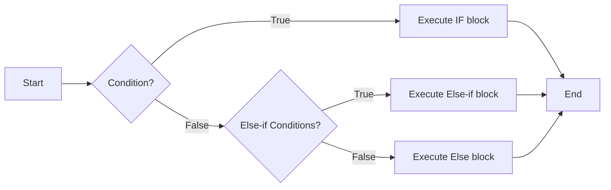
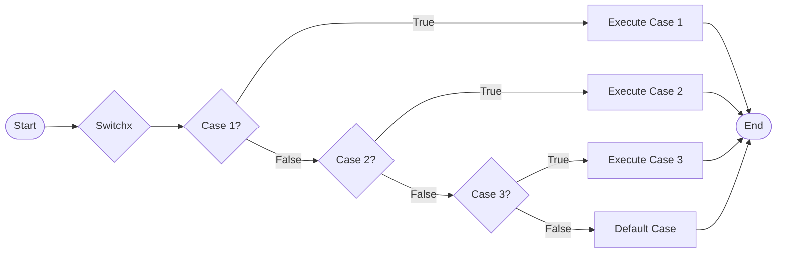
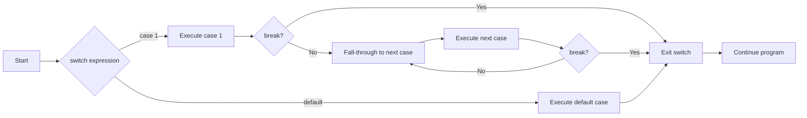

### Control Flow 
- Control flow determines how and in what order statements in a program are executed.
- Three main categories:
  - Selection / Branching
  if, else if, else, switch

  - Iteration / Looping
  for, while, do-while, range-based for (C++)

  - Jump Statements
  break, continue, return, goto



#### IF Condition 
- if 
- if - else
- if - else if -else 
##### General Rules:
1. else if statement is optional, you may have no else if, you may have one, you may have more, no limit.
2. else statement is optional, you can have only one else statement.
``` c++ 
//✔ Valid:
if (x > 0) { ... }
else { ... }
//❌ Invalid:
if (x > 0) { ... }
else { ... }
else { ... }        // ❌ Not allowed
```
3. No code is allowed to be written between if and else if or else.
```c++
if (x > 0) {
    printf("A");
}
printf("Hello");   // ❌ Breaks the chain
else {
    printf("B");
}
```
4. Nested if is allowed.
**But deep nesting is bad practice → use early return or switch instead.**
```c++ 
if (x > 0) {
    if (x % 2 == 0) {
        printf("Positive Even");
    }
}
```
5. if the condition in if statement is a combination between many conditions, use round brackets ( ) with each condition to avoid precedence issues.

- When combining multiple conditions, use parentheses ( )

  - Because operators have precedence:
    - && is evaluated before ||
  - == before &&
- Misuse may change program logic

- Example 
```c++
int a = 0, b = 0;

if (!a && b)       // does NOT execute
if (!(a && b))     // executes → prints "IF"

// !a && b → true only if a is false AND b is true

// !(a && b) → true if at least one of a or b is false
```
```c++
//Remember to use Parentheses with conditions
i=10;
if (!i==5)
if ((!(i == 5))) 
```

❌ Hard to read and error-prone:
```c++ 
  if (a || b && c)
```
- && (logical AND) has higher precedence than || (logical OR)
- || (logical OR) is evaluated after &&

✔ Best practice:
```c++  
  if (a || (b && c))
```
✔ Even better (for clarity):
```c++
  if ( (a == 1) || (b && c) )
  //Even better (for clarity):
  bool ok = (a == 1);
  bool cond = (b && c);
  if (ok || cond) { ... }
```

6. In case of only one action only should be taken in if statement, you may not use { }, but it is always preferred to use { } even if only one action is required
  ```c++
  if (x > 0)
      printf("Positive");
  ```
  ❌ But dangerous! Why?
  - Because adding a new line later causes bugs:
  ```c++
    if (x > 0)
        printf("Positive");
        x++;     // ❌ Programmer thinks it’s inside the if — but it is NOT!
    //or 
    if (x>0)
          printf("Positive");; // ;<-- THIS EMPTY STATEMENT BREAKS THE IF–ELSE CHAIN
    else
      printf("Negative"); // ❌ ERROR: else without matching if

  ```
   - forgetting where to put the semicolon 
   ```c++
    int a=5,b=-3; 
    if (a==b);// ❌
        cout<<a<<"equals"<<b<<endl;
   ```
7. Yoda Conditions in C/C++
- A Yoda Condition is when you write the constant on the left of the comparison:
```c++ 
if (4 == x)   // Yoda style
if (x == 4)   // Normal style
```
**Why using Yoda?**
✔ Prevents accidental assignment inside condition
✔ Prevents silent logical errors

```c++
if (4 == x)
if (4 = x)  // compiler error → easy to detect
```
```c++
if (x = 4)   //  assignment, not comparison
if (4 = x)    // ❌ COMPILATION ERROR
```
- **why if(4=x) Error ?**
  - Because you cannot assign into a literal constant, so the compiler catches the bug immediately.
- **Drawbacks of Yoda Style**
  - Reduces readability
  ```c++
  if (4 == x) is less natural than:  if (x == 4)
  ```
  - Modern compilers catch the assignment error
    ```c++ 
    if (x = 4)
    // With warnings enabled:
    warning: using the result of an assignment as a condition without parentheses
    ```
Best Practice (Modern C/C++)
- Enable warnings:
```bash
g++ -Wall -Wextra -Werror
```
- And write normal conditions:
```c++
if (x == 4)
```
8. Short-Circuiting: 
- **Short-Circuit with && (AND)**
  if (A && B)
  - Evaluation Rules:
    - If A is false → B is not evaluated
    - If A is true → B must be evaluated
  - Reason:
    - For A && B to be true:
    - A must be true
    - B must be true
  - So if A is false → the full expression is guaranteed false → no need to check B.

- **Short-Circuit with || (OR)**
  if (A && B)
  - Evaluation Rules:
    - If A is true → B is not evaluated
    - If A is false → B must be evaluated
  - Reason:
    - For A || B to be true:
    - Either A must be true
    - Or B must be true

  - So if A is true → the whole result is already true → no need to check B.
- **Short-Circuit in Combined Conditions**
  if (A && (B || C))
  - Evaluation Order:

    - Evaluate A
      - If A is false → stop (short-circuit)
    - Evaluate B
      - If B is true → return true (inner short-circuit)
    - Evaluate C
      - Only reached if B is false
    ```c++
    cond && (cond1 || cond2) Optimizations
    - Short-Circuiting:
      The && operator will short-circuit. 
    - This means if cond is false, cond1 || cond2 will not be evaluated at all, 
      which is already an efficient behavior.
    - If cond is true, then the expression evaluates to the result of cond1 || cond2.
    ```

9. floating checking 
```c++
float a = 5.5;
float b = 2.2;
if (a > b) { ... }
if (a == b) { ... }
```
✔ This compiles
✔ This is allowed
❌ But == and != are dangerous with floats

```c++
float x = 0.1 + 0.2;//0.300000012…
float y = 0.3;//0.300000000…
x == y  → false ❌
```
- **Correct way: Use a tolerance (epsilon)**
```c++
float a = 0.1 + 0.2;
float b = 0.3;

float eps = 1e-6;

if (fabs(a - b) < eps) {
    printf("Equal\n");
}
```
10. bitwise vs logical 
```c++
// 2&5  ==> 0
// 2&&5 ==> 1
if (a & b)  // bitwise AND – often wrong
if (a && b) // logical AND – correct
```

##### ✔ Best Practices
- Always use braces {} even for one line.
- Keep conditions simple and readable.
- Use return early to reduce nesting.
- Use boolean variables for complex conditions


##### Examples
 
```c++
int x=10; 
if (x==10){
  printf("Ahmed");
}
x=30;     // ❌ This line breaks the if–else structure
else{
  printf("Youssef");
}
```
- The line x = 30; appears between the if block and the else.
- So the compiler cannot match the else with an if, producing an error like:
```c++ 
error: 'else' without a previous 'if'
```

- Example What's Cond to print Hello mina ?
```c++
		    int x=5;
		    int y=0;
    		if(cond){
                printf("Hello ");
            }else{
                printf("mina ");
            }	    
cond=!printf("Hello ") 
```
- x++ 
```c++
x=0; 
if(x++){    // evaluates as 0 (false)                 
    printf("yes");
}
else{
    printf("No")
}
//Output : No  x=1;
```


#### Switch 
- Used when checking many constant values.


##### General Rules
1. case constant must be unique
    ```c++ 
      case 1:
      case 1:  // ERROR
    ```
2. case constant can’t be a variable
  - Case labels must be compile-time constants
   ``` c++
   int x=5; 
   int y=10;
   switch (y){
    case x://Error 
        //statement ; 
        break;
   }
   ```
   ```c++
    int i=5;
    const int value = 5;  // Not guaranteed compile-time const in C
    //constexpr int value = 5; //C++ 
    switch(i) {
          case value:   // ERROR in C, OK in C++ if truly constexpr
    }
   ```
3. case constant must be integral value(Expression must be integer/enum)
4. Only one default is allowed
5. default label is Optional (Use default for safety)
6. default can be placed anywhere in the switch
7. break Statement ends the switch(Use break to avoid fall-through (unless intended))
8. if the break statement is not exist, the all following code will be executed until the end of the switch or until it finds a break statement without checking the case constant
9.  Nesting ( switch within switch ) is allowed.
10. switch statement only tests for equality 
        No <, >, !=
        If inequalities are needed → use if-else.
11. Don’t switch on floats or strings (C-style)

```c++
enum Color { RED, GREEN, BLUE };

Color c = GREEN;

switch(c) {
    case RED: printf("Red\n"); break;
    case GREEN: printf("Green\n"); break;
    case BLUE: printf("Blue\n"); break;
}
//-----------------------------------------------------------
switch(score) {
    case 90: case 91: case 92: case 93: case 94: case 95:
        printf("Excellent\n"); break;
}
//-----------------------------------------------------------
switch(){
case 1:
    printf("Option 1\n");
    // fall through
case 2:
    printf("Option 1 or 2\n");
    break;
}
//-----------------------------------------------------------
// BAD
switch(x + 1) { ... }
```
| Rule              | Description                             |
| ----------------- | --------------------------------------- |
| Expression type   | Must be integer (`int`, `char`, `enum`) |
| Case constants    | Must be **compile-time constants**      |
| Case uniqueness   | Each case value must be unique          |
| Default           | Optional, executed if no case matches   |
| Switch comparison | Only equality (`==`), no `<`, `>` etc.  |

| Mistake                       | Example                                     | Why it's wrong                                                          |
| ----------------------------- | ------------------------------------------- | ----------------------------------------------------------------------- |
| Using non-integer type        | `switch(3.1f)`                              | float/double not allowed                                                |
| Non-constant case             | `const int x = 5; case x:` (C)              | In C, `const` not always compile-time constant; use `enum` or `#define` |
| Missing `break`               | `case 1: ...` without break                 | Causes **fall-through**, may be unintended                              |
| Duplicate case values         | `case 1:` repeated                          | Compiler error                                                          |
| Misusing `default`            | `default:` in middle of cases without break | Works, but confusing—best at the end                                    |
| Large switch without grouping | Many cases with identical code              | Better to **group cases** or use `enum` mapping                         |


✔ Best Practices
- Always include a default.
- Use break in every case unless fall-through is desired.
- Prefer enum class in C++.

❌ Common Mistakes
- Forgetting a break causing unexpected fall-through.
- Using non-integer types (float NOT allowed).
- Using duplicate case labels.


#### Ternary Operator
```c++
grade >= 50 ? printf("passed") : printf("failed");
```

#### for vs while vs do-while
##### Types Loops :- 

- Entry Controlled loops:
In this type of loop, the test condition is tested before entering the loop body. For Loop and While Loop is entry-controlled loops.

##### Exit Controlled Loops: 

- In this type of loop the test condition is tested or evaluated at the end
of the loop body. Therefore, the loop body will execute at least once, 
irrespective of whether the test condition is true or false. the do-while loop is exit controlled loop.


- for → controlled iteration
  - firstly initializes, then, condition check, execute body, update.
  - used only when we already knew the number of iterations.
- while → repeat while condition is true
  - First checks the condition, then executes the body.
  - used only when the number of iteration are not exactly known.
- do-while → always executes at least once
  - firstly, execute the body then condition check.

| Loop       | Syntax                            | Condition Check  | Run at least once? | Use Case                                    |
| ---------- | --------------------------------- | ---------------- | ------------------ | ------------------------------------------- |
| `for`      | `for(init; condition; increment)` | Before loop body | No                 | When number of iterations is known          |
| `while`    | `while(condition)`                | Before loop body | No                 | Pre-condition loop, unknown iterations      |
| `do-while` | `do { body } while(condition);`   | After loop body  | Yes                | Post-condition loop, must run at least once |


#### continue and break 
##### continue
- Skips the rest of the current iteration and moves to the next.
``` c++

for (int i = 0; i < 10; i++) {
    if (i == 5) {
       continue;// Skip when i == 5
    }
    printf("%d ", i);

}

```

##### **Common Mistake with continue**
##### Using continue without handling counters.
❌ Problems:
  - i is declared inside the for loop, so it does not exist outside that loop.
The syntax is incorrect: while cannot follow a for loop like that unless you are using a do...while structure.

Why is this an infinite loop?

  - When i == 5, the continue statement skips the rest of the loop body, including i++.
So i stays 5 forever, and the condition i < 10 is always true → infinite loop.

```c++ 
while (i < 10) {
    
    if (i == 5) {
        continue;// ❌ Infinite loop (i never increments)
    }
   printf("%d ", i);

    i++;
}
```


✅ Correct version
- You need to increment i before continue:
```c++ 
while (i < 10) {
    
    if (i == 5) {
        i++;
        continue; // Increment before skipping
    }
   printf("%d ", i); //0 1 2 3 4 6 7 8 9

    i++;
}
```


###### **Best Practice:**
- Always ensure loop counters are updated even when using continue.
For clarity, you can restructure logic:
- Always ensure loop counters are updated even when using continue.
For clarity, you can restructure logic:
 ``` c++
 while (i < 10) {
    if (i != 5) {
        printf("%d ", i);
    }
    i++;
}
```

##### break

- Exits the loop immediately.
  ```C++
    for (int i = 0; i < 10; i++) {   
      if (i == 5) break; // Stop loop when i == 5
    }
  ```
- **Using break incorrectly**
  - break only exits the innermost loop, not all loops.
  ```C++
  for (int i = 0; i < 3; i++) {    
    for (int j = 0; j < 3; j++) {        
      if (j == 1) break; // ❌ Only breaks inner loop    }}Show more lines
    }
  }
  ```
  - Mistake: Assuming it breaks both loops.
  - Fix: Use flags or goto (not recommended) or restructure logic.

- **Forgetting that break does NOT exit switch inside a loop**
  ```c++
  for (int i = 0; i < 3; i++) {
      switch (i) {
          case 1: break; // ❌ Break exits switch, NOT the loop
      }
  }
  ```

###### **Overusing break**

- Makes code harder to read.
- Better to use structured logic or return in functions.
- For multiple loop exits, consider:
  - Flags
  - Functions with return

###### Compare break and return
- Purpose
  - break:
    - Exits only the current loop or switch statement, then continues executing the rest of the function.
  - return:
   - Exits the entire function immediately, regardless of how many loops or conditions are active.
- Scope
  - break affects loops (for, while, do-while) and switch.
  - return affects functions.
- Using break
``` c++
for (int i = 0; i < 10; i++) {
    if (i == 5) {
        break; // Stops the loop, but function continues
    }
}
printf("Loop ended\n"); //Loop ended (function continues after loop).
```
- using return 
```c++
void function(){
  for (int i = 0; i < 10; i++) {
      if (i == 5) {
          return; // Exits the entire function
      }
  }
  printf("Loop ended\n"); // ❌ Never executed
}
```
- Common Mistakes
  - Mistake: Using break when you want to exit the function.
  - Mistake: Using return inside a loop without realizing it stops everything.

- Best Practices
  - Use break for loop control, not for function termination.
  - Use return for function exit, especially when a condition invalidates further processing.
  - Avoid multiple return statements scattered in large functions (can reduce readability).

|  Feature   |         break          |          return           |
| :--------: | :--------------------: | :-----------------------: |
|   Exits    | Current loop or switch |      Entire function      |
|   Scope    |       Loop-level       |      Function-level       |
| Common Use |  Stop iteration early  | Exit function immediately |


